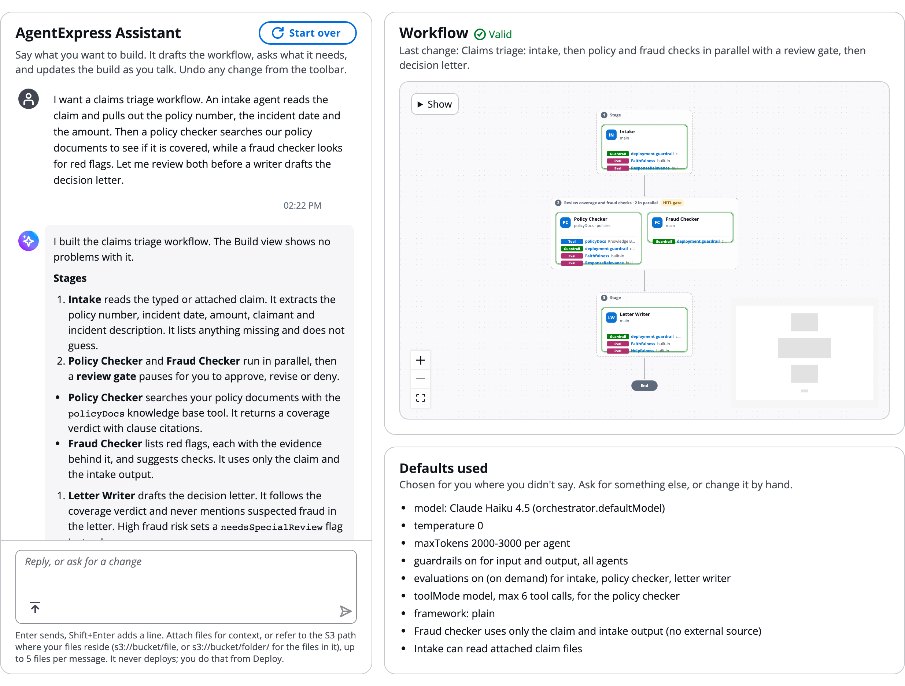
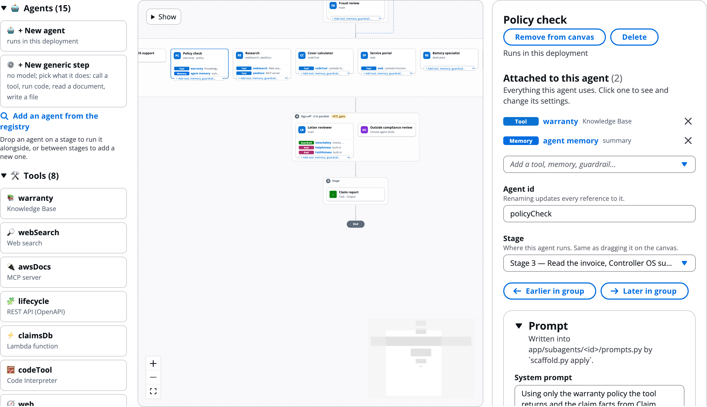
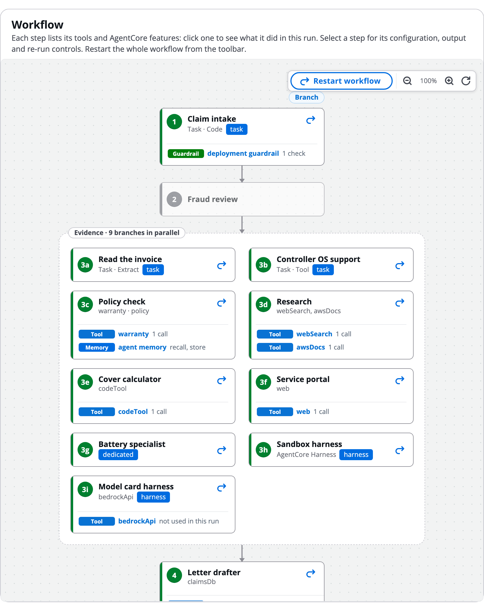
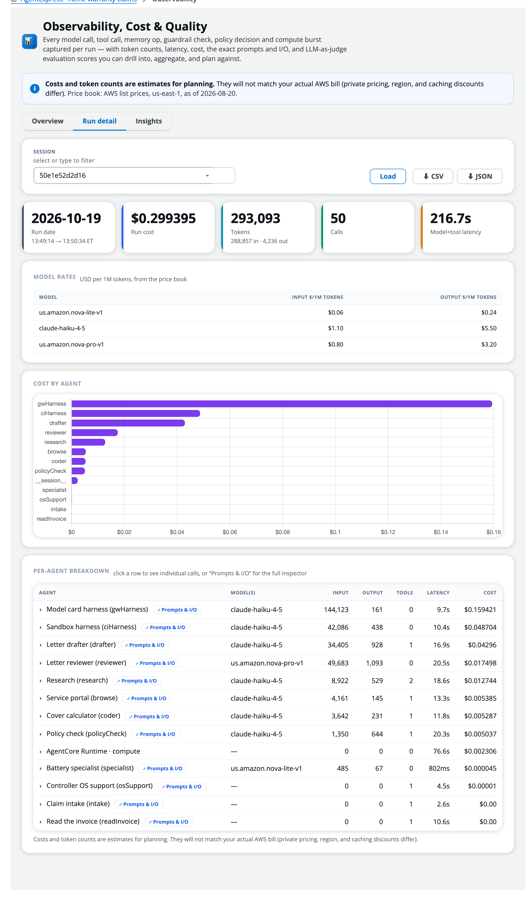
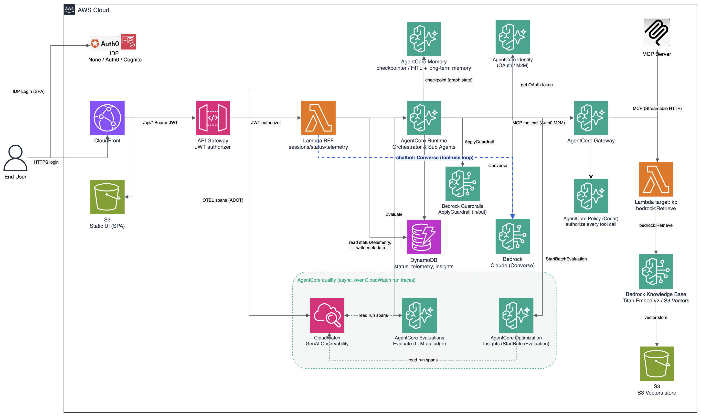

# AgentExpress: Multi-Agent Orchestrator (LangGraph + Amazon Bedrock AgentCore)

AgentExpress is a configuration-driven multi-agent orchestrator built on **LangGraph** and
deployed on **Amazon Bedrock AgentCore**. One file, `workflow.json`, declares the agents, their
topology, tools, review gates, access rules and the AgentCore features each agent uses.
Terraform or CDK turns it into a running system with a web console, and the console's Builder
designs and deploys new workflows. It is a **reference pattern**, not a finished product:
replace the prompts, contracts and documents with your own.

## Watch the demo

https://github.com/user-attachments/assets/c0e1e8a5-a397-4f68-ba9b-e1346109e002

## Inside AgentExpress

### AgentExpress Assistant
Describe your process in plain English. The Assistant drafts the agents, their prompts, tools,
stages and review gates, shows the workflow as it builds it, and lists every default it chose.



### Control plane: the Builder
Design and deploy workflows. Drag agents onto stages, and tools and AgentCore features
(guardrails, memory, Cedar policies, evaluations, identity) onto agents; click any agent or row
to configure it. Deploy with AWS CDK or Terraform, each build to its own execution plane.



### Execution plane: a run
Each deployed build is its own app. A run shows every step, numbered, with the tools, guardrail
and memory it used in that run; HITL gates pause it for approval. **Flow → Story** tells the
same run line by line ([screenshot](orchestrator/docs/images/run-story.png)).



### Observability
Every model call, tool call, guardrail check and policy decision, with tokens, latency and
estimated cost per run and per agent, and each call's prompts and I/O. Runs can also be sent to
Langfuse, Datadog and other tools.



## Feature map

One line per feature; the link goes to the detail.

### Build

| Feature | What it does | Details |
|---|---|---|
| AgentExpress Assistant | A chat that drafts and edits the workflow as you talk; reads public pages you link (`build this based on <url>`); cannot deploy or publish | [GETTING_STARTED](GETTING_STARTED.md#agentexpress-assistant) |
| Assistant versions | Each change the Assistant saves is a named version (`v1: multi-agent draft`); "go back to v1" restores one, and it says which version first | [ARCHITECTURE](ARCHITECTURE.md#7-the-bff) |
| Review changes | Off, Auto (default) or Always: a second model checks the Assistant's larger changes before they're saved, and only advises | [GETTING_STARTED](GETTING_STARTED.md#agentexpress-assistant) |
| Code sources | Code for Lambda tools, interceptors, Run code steps and hosted MCP servers: written or uploaded in the build, from Git or S3, or a private ECR image | [DEPLOYMENT](DEPLOYMENT.md#code-from-files-git-or-s3-code-sources) |
| Canvas | Drag agents onto stages, and tools and AgentCore pieces onto agents; each agent card lists its components; **Show** menu and AgentCore rail | [DEPLOYMENT](DEPLOYMENT.md#the-builder-canvas) |
| Generic step | **+ New generic step**: a step with no model (tool, code, extract, output, deliver); pick the kind in its panel | [DEPLOYMENT](DEPLOYMENT.md#steps-with-no-model-task-steps) |
| Build storage | `orchestrator.storage: {"create": true}`: a private, encrypted, versioned S3 bucket for the build; tools name it `${storage}`; emptied and deleted on destroy unless `retain` | [DEPLOYMENT](DEPLOYMENT.md#storage-created-for-a-build) |
| Connectors | **Tools → Add a connector**: 10 OAuth connectors (Salesforce, Slack, Jira, GitHub, Microsoft 365, …) as ready-made OpenAPI tools | [DEPLOYMENT](DEPLOYMENT.md#connectors) |
| Library | Tools, skills, memory, guardrails, identity, policies, interceptors and evals shared across builds | [GETTING_STARTED](GETTING_STARTED.md#library-and-sharing) |
| AWS Agent Registry | Add approved MCP servers, A2A agents and skills (optionally kept in sync); admins publish a build | [DEPLOYMENT](DEPLOYMENT.md#aws-agent-registry) |
| Teams | Team workspaces with owner, editor and viewer roles; move builds between workspaces | [DEPLOYMENT](DEPLOYMENT.md#teams-and-team-workspaces-builder-console) |
| Sharing, export, import | Share a build; export a bundle or `workflow.json`; `scaffold.py apply <bundle> --exact` | [GETTING_STARTED](GETTING_STARTED.md#export-import-and-moving-a-build) |
| Test suites | Stored cases with fixed checks per build; pass rate by version on the Tests tab | [DEPLOYMENT](DEPLOYMENT.md#test-suites) |
| Kiro skill | `agentexpress-author`: describe a use case, get a workflow | [`.kiro/skills/agentexpress-author/`](.kiro/skills/agentexpress-author/) |

### Agents and runtimes

| Feature | What it does | Details |
|---|---|---|
| `main` / `dedicated` | Run in the orchestrator, or in the agent's own AgentCore Runtime | [WORKFLOW_REFERENCE](orchestrator/docs/WORKFLOW_REFERENCE.md#runtime--where-the-agent-actually-runs) |
| Task steps | `runtime: "task"`: call a tool, run a script in Code Interpreter, read a document with Textract, write a file, deliver the run's files | [WORKFLOW_REFERENCE](orchestrator/docs/WORKFLOW_REFERENCE.md#runtime-task--a-step-with-no-model) |
| Deliver step | `task.kind: "deliver"`: send a run's files to S3, by email with Amazon SES, or to a signed webhook; per-target file filters and conditions | [DEPLOYMENT](DEPLOYMENT.md#delivering-a-runs-files) |
| AgentCore Harness | `runtime: "harness"`: an agent with no code; Gateway tools, managed Code Interpreter and Browser, a named endpoint, or **your own harness by ARN**; other model providers, skills, memory, MCP servers, container, mounts, VPC | [DEPLOYMENT](DEPLOYMENT.md#agents-run-by-agentcore-harness) |
| A2A agents | `runtime: "a2a"`: delegate a step to an agent you do not operate | [GETTING_STARTED](GETTING_STARTED.md#3-add-your-own-agent) |
| Frameworks | Plain, Strands or LangGraph inside `run()`; model calls go through `ctx.llm` | [ARCHITECTURE](ARCHITECTURE.md#frameworks) |
| Prompt caching | Per agent: cache the system prompt, tool definitions or conversation on Claude, Amazon Nova and OpenAI models, within each model's rules | [WORKFLOW_REFERENCE](orchestrator/docs/WORKFLOW_REFERENCE.md#promptcache-prompt-caching) |
| Runtime VPC | Run the orchestrator, a dedicated agent or a hosted MCP server in your VPC; `PUBLIC` by default | [DEPLOYMENT](DEPLOYMENT.md#running-agentcore-runtimes-in-your-vpc) |
| Model routing and fallbacks | Per-agent rules (`inputTokensOver`, `matches`), up to 3 fallbacks, admin per-run override | [DEPLOYMENT](DEPLOYMENT.md#choosing-which-model-answers-per-run-override-routing-and-fallbacks) |
| LiteLLM | `litellm/<model>` for non-Bedrock models through your proxy | [DEPLOYMENT](DEPLOYMENT.md#using-non-bedrock-models-through-litellm) |
| Images | Image agents (`output: "image"`), `vision` on later agents | [GETTING_STARTED](GETTING_STARTED.md#5-images) |

### Tools

Every tool is a Gateway target with a Cedar permit generated from `workflow.json`.

| Type | Reaches | Details |
|---|---|---|
| `kb` | Bedrock Knowledge Base: S3 Vectors by default; chunking and model parsing; your own vector store; web, Confluence, SharePoint and Salesforce sources; reranking | [DEPLOYMENT](DEPLOYMENT.md#knowledge-base-chunking-and-parsing) |
| `websearch` | AgentCore Web Search (us-east-1, eu-west-1, ap-northeast-1) | [GETTING_STARTED](GETTING_STARTED.md#websearch-the-live-web) |
| `mcp` | Any remote MCP server | [GETTING_STARTED](GETTING_STARTED.md#mcp-your-mcp-server) |
| Hosted MCP server | `hosted`: your MCP server code, written, uploaded or linked, runs on its own AgentCore Runtime behind the Gateway | [DEPLOYMENT](DEPLOYMENT.md#hosted-mcp-servers) |
| `openapi` | A REST API from an OpenAPI schema | [GETTING_STARTED](GETTING_STARTED.md#openapi-any-rest-api) |
| `lambda` | Your function, or code written in the build | [GETTING_STARTED](GETTING_STARTED.md#lambda-your-database-or-anything-else) |
| `apigateway` | An API Gateway REST API stage | [GETTING_STARTED](GETTING_STARTED.md#apigateway-an-api-gateway-rest-api) |
| `smithy` | An AWS service API from its Smithy model (RestJson services, 1–20 resource ARNs) | [DEPLOYMENT](DEPLOYMENT.md#tools-that-call-an-aws-api-smithy) |
| Code Interpreter | `source: "codeInterpreter"`: the agent runs code it wrote in the managed sandbox | [DEPLOYMENT](DEPLOYMENT.md#running-code-in-a-sandbox) |
| Browser | `source: "browser"`: open a public page and read its text and links | [DEPLOYMENT](DEPLOYMENT.md#opening-web-pages-with-a-browser) |
| Document generator | `source: "docgen"`: PDF, PPTX and DOCX files from JSON data, into a template in S3 or a built-in layout; saved with the run | [DEPLOYMENT](DEPLOYMENT.md#generating-pdf-pptx-and-docx-files) |
| Acting as the person | `auth: "user"` (each person connects) or `"obo"` (their sign-in) | [DEPLOYMENT](DEPLOYMENT.md#tools-that-act-as-the-person) |

### AgentCore features

| Feature | What it does | Details |
|---|---|---|
| Gateway | One MCP endpoint in front of every tool, JWT-authorized | [ARCHITECTURE](ARCHITECTURE.md#6-agentcore-features) |
| Cedar policy | Default-deny on every tool call; `ENFORCE` or `LOG_ONLY`; custom rules from plain English, a form or Cedar | [GETTING_STARTED](GETTING_STARTED.md#10-tune-features) |
| Guardrails | Bedrock guardrails on input and/or output, build-wide or named per agent | [GETTING_STARTED](GETTING_STARTED.md#10-tune-features) |
| Memory | Checkpoints for pauses; long-term semantic, summary, preference, episodic or custom strategies | [GETTING_STARTED](GETTING_STARTED.md#10-tune-features) |
| Identity and sign-in | Cognito, Auth0, Okta or Entra ID; outbound OAuth2 and API-key credential providers | [DEPLOYMENT](DEPLOYMENT.md#identity-provider) |
| Interceptors | A Lambda before each tool request and after each answer: audit, block, guard, inject, redact (email, phone, SSN, card), hide, cap | [GETTING_STARTED](GETTING_STARTED.md#7-gateway-interceptors) |
| Evaluations | Built-in and custom LLM judges, automatic or on demand | [GETTING_STARTED](GETTING_STARTED.md#10-tune-features) |
| Observability | OTEL spans, tokens, latency and cost per call; Prompts & I/O inspector; prompt cache hits, cost and savings per call and run, and per-agent caching insights | [ARCHITECTURE](ARCHITECTURE.md#6-agentcore-features) |
| Observability export | Send every run to Langfuse, Datadog, Grafana Cloud, Honeycomb or any OTLP backend: pick it, paste the key, **Test connection** (Builder → Settings → Export); run links, re-send and pause in the app | [DEPLOYMENT](DEPLOYMENT.md#send-runs-to-langfuse-datadog-and-others) |
| Skills | SKILL.md know-how an agent opens when needed; never code | [GETTING_STARTED](GETTING_STARTED.md#build-manually) |

### Runs and people

| Feature | What it does | Details |
|---|---|---|
| HITL review gates | Approve, revise or deny after an agent or stage; `threshold` / `auto` modes, EventBridge answers, timeouts | [GETTING_STARTED](GETTING_STARTED.md#9-review-gates-that-decide-for-themselves) |
| Agent asks a person | `askPerson`: the agent asks mid-step and resumes; `approval` on a tool makes each call wait | [DEPLOYMENT](DEPLOYMENT.md#an-agent-asks-a-person-and-tool-calls-that-wait-for-approval) |
| Named options | `hitl.options` (e.g. Override / Abort) on a gate, or `askPerson.options` for an agent mid-step; the choice is the run field `decision` that `branch.when` routes on | [WORKFLOW_REFERENCE](orchestrator/docs/WORKFLOW_REFERENCE.md#named-options--a-persons-choice-decides-what-runs-next) |
| Branch rules | A step's output picks what runs next, skips a stage or ends the run | [WORKFLOW_REFERENCE](orchestrator/docs/WORKFLOW_REFERENCE.md#branch--the-output-decides-what-runs-next) |
| Re-run | Re-run one agent and everything after it, with a note; each run version is kept | [ARCHITECTURE](ARCHITECTURE.md#rewind-and-re-run) |
| Triggers | Signed webhooks, schedules, EventBridge, S3 and SQS start runs | [GETTING_STARTED](GETTING_STARTED.md#8-triggers-runs-nobody-typed) |
| Attachments and files | Files a run starts with; files agents save and code they ran (Files tab and page) | [DEPLOYMENT](DEPLOYMENT.md#a-runs-files-and-the-files-page) |
| Run views | Graph with numbered steps and deployed resource names; Flow tab **Story** and **Summary** with replay; Timeline **Chart** (Gantt) and **Log** | [DEPLOYMENT](DEPLOYMENT.md#the-flow-tab-on-a-run) |
| Share links | Read-only link to one run, with expiry and revoke | [DEPLOYMENT](DEPLOYMENT.md#sharing-a-run-with-a-link) |
| Run Assistant | In-app chat that answers about runs and acts under the same RBAC | [GETTING_STARTED](GETTING_STARTED.md#10-tune-features) |
| A2A endpoint | Serve this workflow to other teams' agents over A2A (off by default) | [DEPLOYMENT](DEPLOYMENT.md#serving-the-workflow-over-a2a) |

### Operate

| Feature | What it does | Details |
|---|---|---|
| Live config | Versioned prompts and model settings with instant rollback, no redeploy | [DEPLOYMENT](DEPLOYMENT.md#changing-a-prompt-or-model-without-redeploying-live-config) |
| Spend and run limits | Per-user daily spend, runs per hour, monthly budget; a run stops at its next step | [DEPLOYMENT](DEPLOYMENT.md#limits-on-spend-and-runs) |
| Cost tag | `agentexpress:app` on every resource, for Billing | [DEPLOYMENT](DEPLOYMENT.md#seeing-the-bill-in-aws) |
| Analytics | Per-tool and per-agent error, latency, denial and block rates, health scores (admins) | [DEPLOYMENT](DEPLOYMENT.md#operational-analytics) |
| Memory records | Browse, search and delete long-term memory records (admins) | [DEPLOYMENT](DEPLOYMENT.md#memory-records-what-agents-remembered) |
| Activity log | Sign-ins, run actions, deploys, changes; everyone's with `audit` | [GETTING_STARTED](GETTING_STARTED.md#activity-and-admins) |
| RBAC | JWT groups mapped to run, build and admin actions | [DEPLOYMENT](DEPLOYMENT.md#users-groups-and-rbac) |
| Organisation guardrails | Permissions boundary, role path, custom domain (TLS 1.2), WAF; one SSRF guard | [DEPLOYMENT](DEPLOYMENT.md#organisation-guardrails) |
| Teardown | One-step destroy, `teardown.sh`, `leftovers.sh` report | [DEPLOYMENT](DEPLOYMENT.md#tear-down) |
| Smoke test | `scripts/e2e_smoke.py` runs a deployed app through every gate and checks it | [scripts/README](orchestrator/scripts/README.md) |

### Deploy

| Feature | What it does | Details |
|---|---|---|
| CDK and Terraform | Twin IaC paths that create the same resources; both build the image and UI from source | [DEPLOYMENT](DEPLOYMENT.md#deploy-with-terraform) |
| Builder deploy | Each build deploys as its own stack from the console's CodeBuild project, with CDK or Terraform | [DEPLOYMENT](DEPLOYMENT.md#how-a-build-deploys) |
| Connected accounts | Deploy builds into other accounts through a role you create there | [DEPLOYMENT](DEPLOYMENT.md#connected-accounts) |
| Console modes | `app` (default: this workflow plus the Builder) or `builder` (control plane only) | [DEPLOYMENT](DEPLOYMENT.md#deploy-a-builder-console) |

## Quick start

```bash
# CDK
cd orchestrator/cdk && npm install
npx cdk bootstrap                    # once per account and region
npx cdk deploy -c idp=cognito -c createCognito=true -c enableGateway=true

# or Terraform
cd orchestrator/terraform && cp terraform.tfvars.example terraform.tfvars
./bootstrap-state.sh                 # remote state, once per account
terraform apply -target=null_resource.ui_build   # first apply of a new stack only
terraform apply
```

You need a container engine that builds `linux/arm64` (Finch, Docker or Podman), Node.js 20+,
AWS credentials and Bedrock model access. Then create a user and groups
([DEPLOYMENT](DEPLOYMENT.md#users-groups-and-rbac)) and open the `uiUrl` / `ui_url` output.

To build your own workflow, open this repository in Kiro and ask:

> Use the agentexpress-author skill to build this workflow. Settle household insurance claims:
> read the FNOL, check the policy wording for coverage, price the repair, and produce a
> settlement decision a human approves.

Paste-ready prompts are in [SAMPLE-PROMPTS.md](.kiro/skills/agentexpress-author/SAMPLE-PROMPTS.md).
By hand, follow [GETTING_STARTED.md](GETTING_STARTED.md).

## What you edit

| You edit | For |
|---|---|
| `orchestrator/app/workflow.json` | Agents, topology, tools, gates, RBAC, guardrails, UI strings |
| `orchestrator/app/subagents/<id>/` | One folder per agent you write: prompt, contract, `run()` (`python3 scaffold.py agent <id>`) |
| `orchestrator/app/tools/<name>/` | Code or schema for a tool that declares `source` |
| `orchestrator/kb_docs/` | Your documents; each top-level folder is a corpus |
| `orchestrator/terraform/terraform.tfvars` or CDK `-c` flags | Account settings: region, sign-in, model, Gateway on or off |

No Terraform, CDK or Cedar edits. A mistake in `workflow.json` fails at `terraform plan` /
`cdk synth` naming the entry. Your editor completes keys from `workflow.schema.json`. Every
key is in [WORKFLOW_REFERENCE.md](orchestrator/docs/WORKFLOW_REFERENCE.md).

## The sample workflow

Nine agents in four stages ([`workflow.json`](orchestrator/app/workflow.json)):

```
1 intake ─(HITL)─▶ 2 [ knowledge_research ‖ web_search ‖ documentation_search
     │                 ‖ cost_research ‖ lifecycle_research ]
     │                 ─(HITL)─▶ 3 [ analysis → recommendation ] ─(HITL)─▶ 4 report
     ├──(branch)──▶ 3, skipping research, if the brief has no research questions
     └──(branch)──▶ END, if the brief has no objective at all
```

The research agents use five tool types (KB, web search, MCP, Lambda, OpenAPI);
`analysis` and `recommendation` are A2A agents served by a stand-in Lambda.
A second example, [`examples/demo-everything/`](orchestrator/examples/demo-everything/), uses
every tool type and AgentCore feature in one run.

## Architecture



Browser → CloudFront (S3 UI) and API Gateway (JWT authorizer) → BFF Lambda → the orchestrator on
AgentCore Runtime (LangGraph), which calls dedicated runtimes, harnesses, A2A agents and the
AgentCore Gateway (Cedar-enforced tools). State is in AgentCore Memory and DynamoDB. The UI is
React on Cloudscape. Details: [ARCHITECTURE.md](ARCHITECTURE.md). The diagram's source is
[`architecture.drawio`](architecture.drawio).

## Repository map

```
.kiro/skills/agentexpress-author/  Kiro skill: describe a use case, get a workflow
docs/user-guide/    the user guide (Markdown and screenshots) the UI's info icons link to
orchestrator/
├── app/            workflow.json, subagents/, tools/ (yours); common/, features/, orchestrator/ (framework)
├── web/            console UI (Vite, React, Cloudscape)
├── bff/            Lambda BFF: API, RBAC, assistants, Builder, library
├── deployer/       CodeBuild runner that deploys builds
├── a2a_lambda/     stand-in A2A server (its own Lambda and Function URL) for the sample's a2a agents
├── kb_lambda/      Gateway Lambda target that retrieves chunks from a Bedrock Knowledge Base
├── signup_lambda/  Cognito triggers: default group for a self-registered user, and the sign-in log
├── kb_docs/        Knowledge Base corpora (yours)
├── examples/, scripts/, docs/   demo build, smoke test, reference docs
├── tests/          pytest (no AWS, no model)
├── cdk/            CDK app
├── terraform/      Terraform
├── scaffold.py     reset the sample, add an agent, or apply a bundle exported from the Build view
├── build_schema.py generate workflow.schema.json, defaults.json and the UI's builder-meta.json (--check for CI)
├── format_workflow.py  format app/workflow.json for reading
├── leftovers.sh    list what a destroy left behind (tagged agentexpress:app=<agent_name>); deletes nothing
├── docs_default.json   the user-guide URL the UI links to when no docsUrl is set (read by CDK and Terraform)
└── VERSION         framework version, stamped into exported bundles
```

## Documentation

| Doc | Covers |
|---|---|
| [User guide](docs/user-guide/README.md) | Using AgentExpress, page by page: the control plane, every feature, deploying, running and observing. The app's info icons link here |
| [GETTING_STARTED.md](GETTING_STARTED.md) | Deploy the sample, connect your data, add agents, use the Builder |
| [DEPLOYMENT.md](DEPLOYMENT.md) | Both IaC paths, sign-in, RBAC, every operational feature, teardown, troubleshooting |
| [ARCHITECTURE.md](ARCHITECTURE.md) | Components, request flow, runtime, BFF, stores, security model |
| [WORKFLOW_REFERENCE.md](orchestrator/docs/WORKFLOW_REFERENCE.md) | Every `workflow.json` key |
| [cdk/README.md](orchestrator/cdk/README.md) | CDK context flags |

## Security summary

This is a reference sample, not a hardened product. Review it before non-sandbox use. Details
are in [ARCHITECTURE.md](ARCHITECTURE.md#11-security-model).

**Built in**
- Sign-in (Cognito, Auth0, Okta or Entra ID) and a JWT authorizer on `/api/*`; the one
  exception is a webhook trigger's route, proven by an HMAC signature.
- Machine tokens for agent → Gateway calls, pinned to the calling client.
- Cedar default-deny at the Gateway, so an injected prompt cannot widen tool access.
- RBAC on run and build actions; the assistants are held to the same rules.
- Scoped IAM roles per component; optional permissions boundary and role path.
- No secrets in the repo; runtimes read theirs from Secrets Manager.
- Point-in-time recovery, TLS-only encrypted buckets, API logs and throttle, CloudFront security
  headers, strong Cognito passwords with optional MFA, pinned dependencies, immutable ECR.
- Scanned with cdk-nag and checkov; each accepted finding has its reason.

**Harden before production**
- `idp = "none"` leaves the app open; both paths refuse it without `allow_unauthenticated`.
- Run and build ownership is enforced in the BFF, not in the tables.
- The deploy project can create IAM roles: restrict `deploy` and `destroy`. A CDK deploy runs
  as the bootstrap execution role (AdministratorAccess unless bootstrapped narrower).
- Add a custom domain and WAF; turn on bucket versioning and retention for real data.
- Replace the sample guardrail and Cedar rules.
- Telemetry stores prompts and outputs; lower `OBS_MAX_CAPTURE_CHARS` if inputs are sensitive.
- Guardrail PII filters are a control, not compliance; HIPAA, PCI DSS and GDPR remain your
  responsibility under the [AWS shared responsibility model](https://aws.amazon.com/compliance/shared-responsibility-model/).

**Cost.** Serverless (AgentCore, Lambda, on-demand DynamoDB, S3 Vectors); Claude Haiku is the
default model. Evaluations, guardrails, Code Interpreter and Browser sessions and Transaction
Search above 1% cost extra; the Observability tab meters them.

## Security and license

See [CONTRIBUTING](CONTRIBUTING.md#security-issue-notifications) for more information.

This library is licensed under the MIT-0 License. See the [LICENSE](LICENSE) file.
