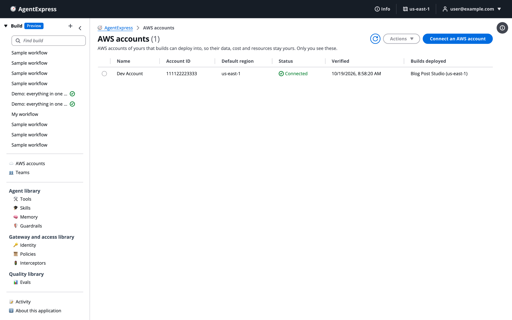

# Set up AWS accounts

Builds deploy into the control plane's own AWS account unless you connect one of yours. A connected account keeps a build's data, cost and resources in your account. On the **AWS accounts** page you connect an account, see the deploy role the connection creates, set its default region, and manage it later.

Connecting needs the `deploy` permission, because it creates a deploy role. A connected account is private to you: only you see it and deploy into it.

# Open the AWS accounts page

Click **AWS accounts** in the left pane of the control plane. The page lists the accounts you connected. Until you connect one, builds deploy into the control plane's own account.

The AWS accounts page with one connected account:

| Column | What it shows |
|---|---|
| **Name** | The name you gave it, for example _Team sandbox_. |
| **Account ID** | The 12-digit account ID. |
| **Default region** | Where a new deploy goes unless you pick another. |
| **Status** | **Connected**, or _Waiting for its stack_ when the connection stack is not created yet. |
| **Verified** | When the connection was last checked. |
| **Builds deployed** | Your builds deployed there, with their Regions. |

# Connect an account

1. Click **Connect an AWS account** on the **AWS accounts** page, or pick **Connect an AWS account…** under **Deploy to** in the Deploy dialog.
1. Type the **AWS account ID** (12 digits), an optional **Name**, and the **Default region**.
1. Click **Continue**.
1. Sign in to that account and click **Launch stack in AWS**. It creates one CloudFormation stack in about a minute. Or download the template and run the AWS CLI command shown. The template link is valid for an hour.
1. When the stack shows `CREATE_COMPLETE`, click **Verify connection**.

The Connect an AWS account dialog explains the role before you start:

**Verify connection** assumes the role once and shows the reason if it fails, for example no such role, a trust or External ID mismatch, or a service control policy.

# What the connection creates

The stack creates one IAM role in your account, `AgentExpressDeploy-…`:

- Only this control plane's deploy project and API can assume it, and only with an External ID unique to you and that account.
- It is not an administrator. It can read the account, create, change and delete only what a build deploys, and bootstrap AWS CDK there.
- Delete its stack to disconnect it completely. The stack's name starts with `AgentExpressConnect-`.

> [!NOTE]
> A CDK deploy runs as the CDK bootstrap's CloudFormation execution role, which has AdministratorAccess unless the account was bootstrapped with a narrower policy. Bootstrap the account yourself with a narrower policy first if that matters. Terraform builds run with the deploy role's own permissions.

# Pick the region

- The **Default region** is filled in when you pick the account under **Deploy to**. You can pick any other Region of the account: its deploy role works in all of them.
- Changing the default later does not move a build already deployed. It stays in its Region.
- The control plane refuses a Region that cannot run something the build uses, before the deploy starts.
- One connection works in every Region of the account. Its deploy role is an IAM role, and IAM is global. You do not connect the account again, or create the role again, for another Region.

## Move a build to another Region

- Destroy the build first. Then pick the new Region under **Deploy to** and deploy it.
- A build deployed from now on gets bucket names that end with its Region. It can move to another Region without a name clash.
- A build deployed before this keeps its bucket names, so nothing in them is lost. If you destroy it and deploy it in another Region straight away, the deploy can fail with "A conflicting conditional operation is currently in progress". S3 is still releasing the old bucket names. Wait 30 to 60 minutes, then deploy again.
- If a first deploy fails, deploy again: the failed stack, and the files it had uploaded, are removed first. A stack that deployed even once is never removed this way.

## Deploying there

- A build in a connected account runs from its own execution plane, not from this control plane. **Run here** is not offered.
- With Terraform, the state stays in the control plane's account.
- If the control plane sets a permissions boundary on the roles it creates, a build in a connected account uses the policy of the same name in that account, so create it there too.

# Manage a connected account

Select an account's row, then open **Actions**:

| Action | What it does |
|---|---|
| **Edit name and region** | Renames it, or changes its default region. |
| **Check the connection** | Assumes the deploy role once and says whether it works, with the reason if not. |
| **Finish connecting** | For an account still waiting for its stack: shows the stack step again. |
| **Update its role** | Brings the deploy role up to date after the control plane is upgraded. Update the connection stack with the new template (or the AWS CLI command shown), wait for `UPDATE_COMPLETE`, then click **Verify connection**. |
| **Disconnect** | The control plane forgets the account. Refused while a build of yours is deployed there: destroy those first. |

Disconnecting does not delete the role in your account. To remove it, delete the connection stack in that account.

# Ask the Assistant

The AgentExpress Assistant can't connect, check, update or disconnect an AWS account, and it can't pick where a build deploys. Use the **AWS accounts** page, and **Deploy to** in the Deploy dialog.

More about what it can do is on [Ask the Assistant](Ask_the_Assistant.md).

# Related pages

- [Deploy a build](Deploying_a_Build.md): pick the account under Deploy to.
- [Sign-in and security](Security.md): permissions boundaries and other organisation guardrails.
- [Clean up](Clean_Up.md): destroy builds before you disconnect.
- [Troubleshooting](Troubleshooting.md): when an account cannot be verified.
