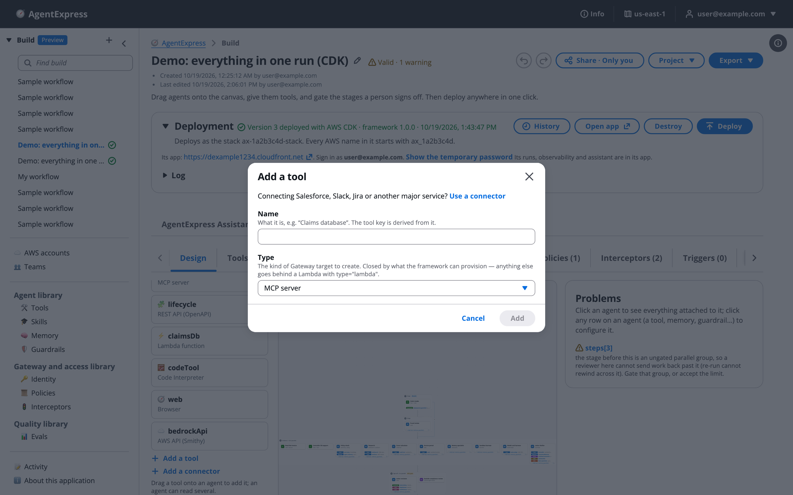
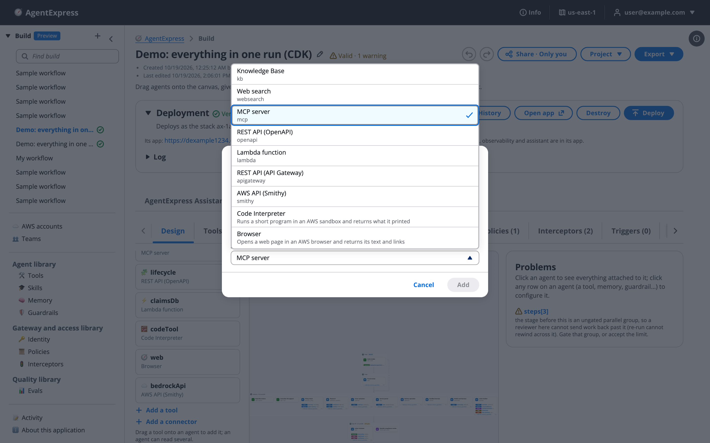
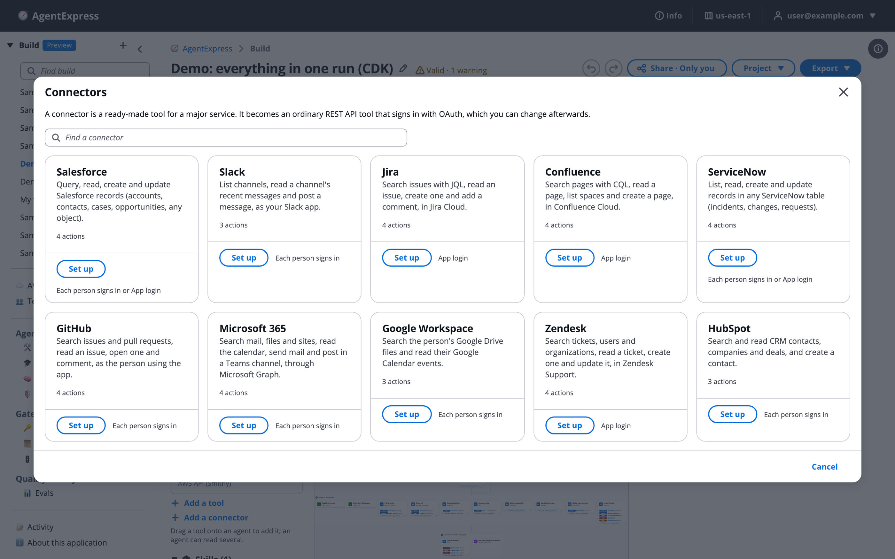
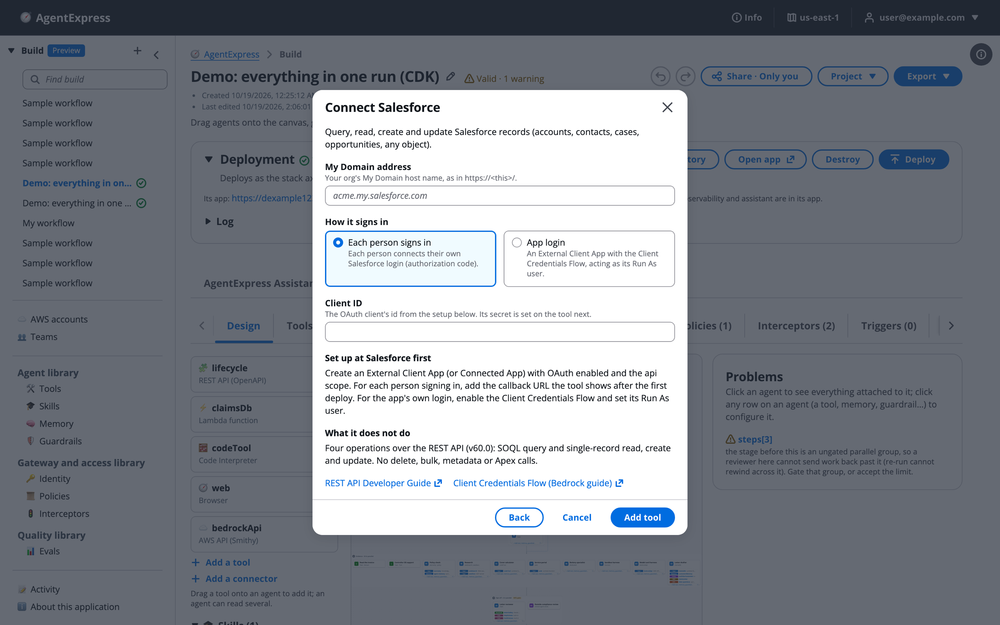

# Add tools and connectors

A tool is a data source or an action an agent can call: a knowledge base, web search, an MCP server, a REST API, a Lambda function, an AWS API, a Code Interpreter sandbox or a browser. Use this when an agent needs data or an action: add a tool or a ready-made connector, give it to an agent, pick how it signs in, and pick how the agent uses it. Every call goes through the build's AgentCore Gateway, explained on [Tools tab and the Gateway](Tools_and_Gateway.md).

# Add a tool

1. Click **Add a tool**, on the **Tools** tab or under **Tools** in the palette.
1. Type a **Name**, for example _Claims database_. The tool key is made from it.
1. Pick a **Type**.
1. Click **Add**. The tool opens on the Design tab, where you fill in its settings.

The Add a tool dialog:

The types you can pick:

What each type reaches and the settings it needs are on [Tool types in depth](Tool_Types.md). An **MCP server** tool can point at a server you run, or AgentExpress can host your server code on its own AgentCore Runtime: see [Host an MCP server here](Tool_Types.md#host-an-mcp-server-here). The AgentExpress Assistant can also add a tool for you, including the code of a Lambda tool or a hosted MCP server, and an OpenAPI document.

# Give an agent a tool

- Drag the tool from the palette onto an agent's card. An agent can have several tools.
- Or pick it under **Tool** in the agent's settings, or with **+ Add tool, memory, guardrail…** on the card.

A remote (A2A) agent takes no tool, because it reaches its own sources. A generic step calls the one tool its settings name. An agent with no tool still works: it reasons over the request and the approved output of earlier stages.

# Pick how the agent uses tools

An agent's **tool mode** decides how it calls its tools:

| Tool mode | What happens | Use it when |
|---|---|---|
| `direct` | Every tool is called once before the model reasons, and the results reach the model as labelled evidence | Each tool has one obvious call |
| `model` | The model picks which tools to call and with what arguments, up to `maxToolCalls` (default 6) | A tool publishes several operations, or the agent should decide |

New agents in the control plane start in `model` mode. Only a `model`-mode agent can ask a person a question or open skills on demand. Cedar policy and telemetry apply in both modes.

# Add a connector

A connector is a ready-made tool for a major service. It becomes an ordinary REST API (OpenAPI) tool that signs in with OAuth, which you can change afterwards.

1. Click **Add a connector** (on the Tools tab or in the palette), or **Use a connector** in the **Add a tool** dialog.
1. Find the service, or type in **Find a connector**, and click **Set up**.
1. Fill in the form: the service's site or tenant, **How it signs in**, and the OAuth **Client ID**.
1. Click **Add tool**. The tool opens on the Design tab.
1. Under **How it connects**, set the client secret.
1. If each person signs in, deploy once, then register the callback URL the tool shows at the service.

The Connectors gallery:

| Connector | You supply | What it can do |
|---|---|---|
| Salesforce | My Domain host, client ID | SOQL query; read, create and update a record |
| Slack | Client ID | List channels, read history, post a message as your Slack application |
| Jira | Cloud ID, service account's client ID | JQL search, read and create issues, comment |
| Confluence | Cloud ID, service account's client ID | CQL search, read a page, list spaces, create a page |
| ServiceNow | Instance name, client ID | Table API list, read, create, update |
| GitHub | Client ID (OAuth application) | Search issues and pull requests, read and open issues, comment |
| Microsoft 365 | Tenant, client ID (Entra application) | Microsoft Search, calendar view, send mail, post in Teams |
| Google Workspace | Client ID | Search Drive files, file details, calendar events |
| Zendesk | Subdomain, client ID | Search, read, create and update tickets |
| HubSpot | Client ID | Search and read contacts, companies and deals; create a contact |

The form for one connector says what to set up at the service first, and what the connector does not do:

- Each connector covers a few common operations of the service's REST API. Edit the tool to add more.
- A connector publishes several operations, so give it to an agent in `model` tool mode. A `direct` agent needs `call` set to one operation.
- The values you type are checked against the service's own domain before they go into a URL.

# Choose how a tool connects

Each tool's settings have a **How it connects** box. It says how the Gateway signs in to the tool:

- MCP and OpenAPI tools: **Public**, **IAM role**, **API key**, **App login** (the build's own OAuth client), **User login** (each person connects their own account) or **On behalf of user** (the person's own sign-in).
- API Gateway tools: **Public**, **IAM role** or **API key**.
- Knowledge base, Lambda and Smithy tools always use the build's Gateway role (**IAM role**). Web search is managed by AWS.

Keys and client secrets go in write-only fields, or in a saved login on the [Identity](Identity.md) tab. The agent never sees them. Tools that act as the person are on [Tool types in depth](Tool_Types.md).

# Ask the Assistant

The AgentExpress Assistant can add a tool of any type, give it to agents, set each agent's tool mode and call limit, and set how the tool connects. Paste a link to an API's public docs or OpenAPI document ("Build this tool based on &lt;address>"), or attach the document, and it works from that. Requests you can paste:

- "Add a web search tool limited to [docs.aws.amazon.com](https://docs.aws.amazon.com/) and give it to the research agent"
- "Add a REST API tool from the OpenAPI document at &lt;its address>, signing in with an API key"
- "Let the claims agent pick its own tool calls, at most 4 per step"
- "Make the crm tool sign in with App login, OAuth client credentials"

What it does not do here:

- **Connectors**: it cannot open the connector gallery. Use **Add a connector**, or ask it for a REST API (OpenAPI) tool for that service instead.
- **Keys and client secrets**: it names the secret a tool needs in the **Secrets** card, and you type the value there or under **How it connects**, never in the chat.
- **Callback URLs** for **User login** tools are registered at the service, after a deploy.

With **Review changes** on **Auto**, a new tool or a change to how one connects is checked by a second model before it is saved. More requests are on [Ask the Assistant](Ask_the_Assistant.md).

# Related pages

- [Tools tab and the Gateway](Tools_and_Gateway.md): the build's tools, and the Gateway every call goes through
- [Tool types in depth](Tool_Types.md): each tool type's settings
- [Policies (Cedar)](Policies_and_Cedar.md): rules on every tool call
- [Library](Library.md): share a tool across builds
