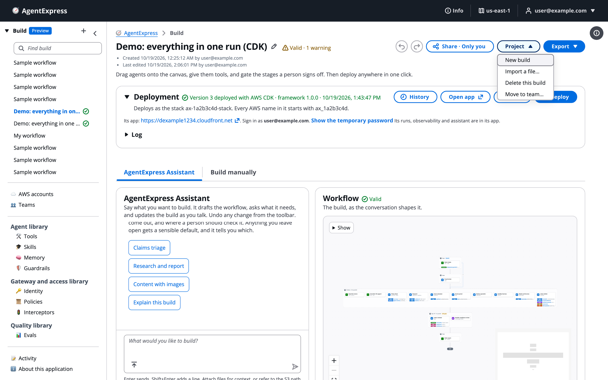

# The control plane

The control plane is where you keep your builds and design, share and deploy them. Use it to find your builds in the left pane, read a build page, rename and undo, check problems before you deploy, and use the **Project** menu.

# Use the left pane

The left pane lists your builds and the control plane's other pages.

| Item | What it does | Read |
|---|---|---|
| **Build** (_Preview_) | Your builds, each with a status icon. **+** starts a new build. | Below |
| Workspace switcher | Above the build list when you are in a team: **My builds** or one of your teams | [Teams and workspaces](Teams.md) |
| **Find build** | A filter box shown when the list holds more than six builds |  |
| **AWS accounts** | Accounts of yours that builds can deploy into | [Set up AWS accounts](AWS_Accounts.md) |
| **Teams** | Teams you belong to; admins create them here | [Teams and workspaces](Teams.md) |
| Library groups | **Agent library**, **Gateway and access library**, **Quality library** | [Library](Library.md) |
| **Activity** | Your sign-ins, builds, deploys and run actions | [Activity](Activity.md) |
| **Admin** | Every user's builds, read-only. Admins only. | [Users, groups and RBAC](Users_Groups_and_RBAC.md) |

In the build list:

- Click a build to open it. The open build is highlighted.
- A green tick next to a build means it is deployed.
- The delete icon next to a build deletes it. A deployed build is destroyed first.
- When you pick a team in the workspace switcher, the list shows that team's builds, and a new build is created in that team.

Builds and runs are private to their creator unless shared. Someone without access to a build gets "not found", as if it did not exist.

# Read the build page

A build page for the example build, with the Deployment panel open:

From top to bottom:

1. **Header.** The build's name, its validation status, and the **Undo**, **Redo**, **Share**, **Project** and **Export** buttons.
1. **Who and when.** When the build was created and by whom, and when it was last edited and by whom.
1. **Deployment panel.** The deploy status and the **History**, **Open app** (opens the build's execution plane), **Destroy** and **Deploy** buttons. Click its title to fold it. See [Deploy a build](Deploying_a_Build.md).
1. **Two tabs.** **AgentExpress Assistant** (build by chat) and **Build manually** (the canvas and the configuration tabs).
1. **Save line.** At the bottom: a note that builds save automatically to your account in this control plane, or the time of the last save.

## Messages at the top of a build

- _You can look at this build, not change it_: you are a viewer in the build's team, so your changes are not saved.
- _Newer versions in the registry_: an item you took from the AWS Agent Registry has a newer approved version. See [AWS Agent Registry](Agent_Registry.md).

# Rename and save

To rename a build, click the pencil next to the name (or double-click the name), type the new name, and press Enter. Escape cancels. If the execution plane's title (`ui.title`) or heading (`ui.heading`) still showed the old name, it is renamed too. Changing the title on the **Settings** tab renames the build.

There is no save button. Each change is saved a moment after you stop typing, including an unfinished build with errors. If a save fails, the save line says _Not saved_ with the reason, and the next change retries it. When two people edit a shared build at once, the later of two saves that started from the same version is refused, and the save line offers **Reload now**.

# Undo and redo

The **Undo** and **Redo** buttons are the two arrows at the left of the header. One history covers:

- each change the AgentExpress Assistant made;
- edits on the canvas and in the settings panels;
- a file you imported into the build;
- dropping a guardrail, memory, policy or other piece onto an agent;
- taking a row off an agent card. The notice says _Undo puts it back_.

Typing in a field is merged into one step, so one Undo does not take back one letter at a time. **Start over** on the Assistant clears the conversation only; Undo still works.

# Check problems before you deploy

The control plane checks the build as you edit it, with the same rules the deploy uses.

- **Header status.** **Valid**, or a count such as _2 errors · 1 warning_. Click it to open the **Problems** list.
- **Problems list.** Each problem names where it is (an agent, a tool, a stage such as `steps[3]`, or a block) and what is wrong. Click one to jump to it.
- **On the canvas.** An agent or stage with errors shows a red count badge. With nothing selected, the right-hand panel lists the problems.
- **On the tabs.** The **Tools** tab and the named-item tabs have a **Problems** column.

| Kind | What it means | What it blocks |
|---|---|---|
| Error | The build cannot deploy as it is: a missing value, a tool no agent can reach, a model that cannot do what the agent asks, a generic step with no kind | **Deploy** and the **Bundle** export |
| Warning | The build can deploy, but something may not work as you expect | Nothing |

The server checks the build again when you deploy. When there are no problems, the list says _No problems. This build is ready to deploy._

# Use the Project menu

The **Project** menu in the header holds actions on the build as a whole.

The Project menu open on the example build:

| Item | What it does |
|---|---|
| **New build** | Opens a fresh build named _My workflow_. Same as **+** next to **Build**. |
| **Import a file…** | Reads a `workflow.json` or an exported bundle. See [Export, edit and import](Export_and_Import.md). |
| **Delete this build** | Deletes the build and every stored version. A deployed build is destroyed first with the tool it was deployed with. This cannot be undone. |
| **Move to team…** | Puts the build in a team's workspace where you are an editor or owner. See [Teams and workspaces](Teams.md). |

> [!WARNING]
> Deleting a build removes its runs along with its execution plane. Export it first if you may want it back.

The **Export** menu and the **Share** button are on [Export, edit and import](Export_and_Import.md) and [Share a build](Sharing_a_Build.md).

# Ask the Assistant

The AgentExpress Assistant can rename the build, undo its own last change, and explain or fix what the **Problems** list shows. It sees the same problems you do. Requests you can paste:

- "Rename this build to Warranty claim triage"
- "Undo that"
- "What do the two errors in Problems mean? Fix them"

It cannot act on the header or the menus. Do these yourself:

- **Redo**: the Redo button in the header.
- New, import, delete or move a build: the **Project** menu. The Assistant can read an attached `workflow.json` as reference, but **Project → Import a file…** is what loads it.
- Download or bundle the build: the **Export** menu. Share it: **Share**.
- Deploy, redeploy or destroy: the Deployment panel.

More requests for every feature are on [Ask the Assistant](Ask_the_Assistant.md).

# Related pages

- [Build with the AgentExpress Assistant](AgentExpress_Assistant.md): build by chat
- [Build manually on the canvas](Canvas.md): build by hand
- [Share a build](Sharing_a_Build.md): let others open and deploy it
- [Deploy a build](Deploying_a_Build.md): the Deployment panel
