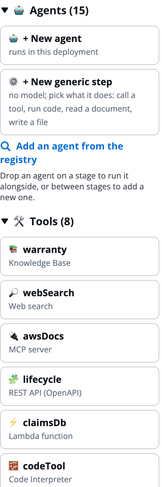
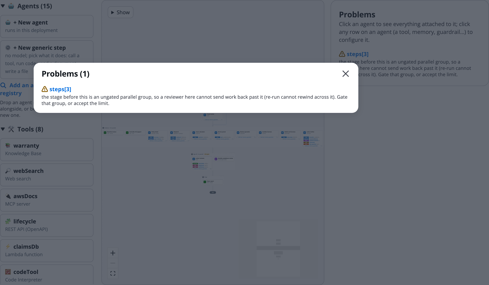
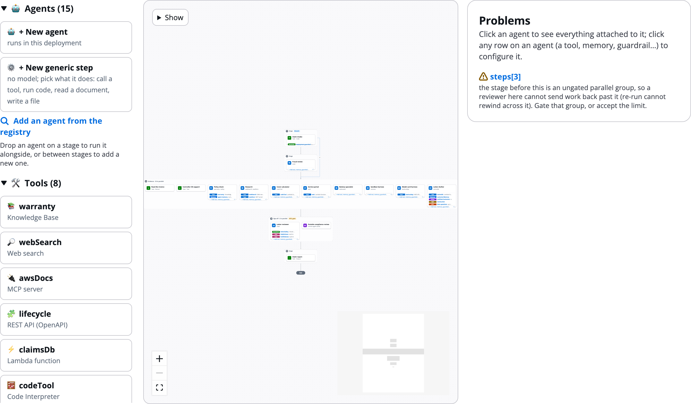

# Build manually on the canvas

The canvas is the **Design** tab of **Build manually**. It draws the workflow as stages from top to bottom, with each stage's agents inside it. Use it to build a workflow by hand, or to review and adjust what the AgentExpress Assistant drafted. You change the workflow by dragging, and every drag also has a button or menu, so you can do everything by keyboard.

# Open the canvas

Open a build, click **Build manually**, and stay on the **Design** tab. The control plane with the palette on the left, the canvas in the middle, and the selected agent's settings on the right:

| Column | What it holds |
|---|---|
| Palette (left) | Agents to add, the build's tools, and one group per kind of piece: skills, memory, guardrails, Cedar policies, evaluators, interceptors and triggers |
| Canvas (middle) | The stages, agent cards, arrows between stages, and **End**. **Show** is at the top left, the zoom controls at the bottom left, and a minimap at the bottom right. |
| Settings panel (right) | The settings of what you selected: an agent, a stage, a tool, a row of an agent card, or a piece of the AgentCore rail. With nothing selected it lists the build's **Problems**. |

The canvas is drawn from the workflow itself. Dragging an agent changes which stage it is in, and the canvas redraws, so what you see is always a shape the workflow can run.

The other tabs of **Build manually** each configure one part of the build; see [Tools tab and the Gateway](Tools_and_Gateway.md) and the pages that follow it.

# Use the palette

The palette's top groups: **Agents** and **Tools**:

- **Agents**: **+ New agent**, **+ New generic step**, **Add an agent from the registry**, and agents not on the canvas yet.
- **Tools**: the build's tools, **Add a tool** and **Add a connector**.
- Then one group for each kind of piece the build has. Each group shows a count and can be folded.

Clicking a piece in the palette opens its tab. Pressing Enter or Space on a palette agent adds it as a new stage at the end.

# Add and move agents

To add an agent:

1. Drag **+ New agent** from the palette onto the canvas.
1. Drop it **on a stage** to run it alongside the agents there, or **between two stages** to make a new stage.
1. Name it and write its prompt in the settings panel.

Or click **+ New agent** to add it as a new stage at the end. **+ New generic step** adds a step with no model; see [Stages and steps](Stages_and_Steps.md). **Add an agent from the registry** imports an approved A2A agent; see [AWS Agent Registry](Agent_Registry.md).

To move an agent, drag its card to another stage or between stages, or change **Stage** in its settings. Within a parallel or sequence stage, use **Earlier in group** and **Later in group**.

**Remove from canvas** keeps the agent in the build and lists it in the palette as _not on the canvas_. **Delete** removes it from the build.

# Drag pieces onto agents

Drag a tool from the palette onto an agent to give it that tool; see [Add tools and connectors](Adding_Tools.md). The lower palette groups work the same way. While you drag, the canvas marks where the piece may go. A drop writes the same settings as the settings panel, as one undo step.

| Piece | Where it goes |
|---|---|
| Guardrail | An agent that runs in the deployment (not A2A). On an agent with no checks, it turns on both input and output checks. |
| Memory, skill, evaluator | An agent that runs in the deployment (not A2A) |
| Cedar policy | A **Tool** row on an agent card. It governs that tool for every agent that calls it. |
| Trigger | The first stage. The trigger is turned on. |
| Interceptor | No target: it runs on every tool call at the Gateway |

**Attach** and **Detach** in an agent's settings do the same by keyboard. Rows on an agent card are explained on [Agents](Agents.md).

# See problems on the canvas

With nothing selected, the settings panel lists the build's **Problems**. Click the status next to the build's name to open the same list over the canvas, and click a problem to select what it is about.

The Problems list open over the canvas, with one warning on `steps[3]`:

The Design tab with the Problems panel on the right when nothing is selected:

More on [The control plane](Builder_Console.md).

# Choose what cards show

**Show** at the top left of the canvas decides what the agent cards list. It changes only the view, never the workflow.

1. Click **Show**.
1. Under **Show on agents**, clear the kinds of row you do not need: **Tools**, **Guardrails**, **Memory**, **Cedar policies**, **Skills**, **Evaluations**, **Identity** or **HITL**.
1. Tick **AgentCore rail** to show the deployment-wide pieces.

When some kinds are hidden, the button says so, for example **Show (2 hidden)**.

The AgentCore rail lists the pieces that apply to the whole deployment, with counts: **Gateway**, **Memory**, **Policy engine**, **Guardrail**, **Identity**, **Observability** and **Triggers**. Click one to open it in the settings panel. The rail also appears while you drag a piece from the palette.

# Zoom and keyboard

- Use **+** and **−** at the bottom left to zoom, and the frame button to fit the whole workflow. Fitting never zooms in past 100%.
- Drag the background to pan, or drag in the minimap to move around a large workflow.
- Delete or Backspace takes the selected card row off its agent (not while you type in a field).
- **Undo** and **Redo** in the build header cover every canvas change.

An empty canvas says _Drag New agent here to start_.

# Ask the Assistant

Anything you do by dragging, the AgentExpress Assistant can do from a sentence: add, change, rename or delete an agent, and put agents in stages or reorder them. The canvas redraws with the same result as a drag, and each change is one undo step. Requests you can paste:

- "Add an agent that summarises the claim, as a new stage after intake"
- "Move the research agent into the policy check's stage so they run in parallel"
- "Rename the agent id policyCheck to policyReview"
- "Delete the letter writer"

**Show**, zoom and the minimap only change your view, so the Assistant has no setting for them: use the canvas controls.

More requests are on [Ask the Assistant](Ask_the_Assistant.md).

# Related pages

- [Stages and steps](Stages_and_Steps.md): stage shapes, gates, branches and generic steps
- [Agents](Agents.md): agent cards and the settings panel
- [Add tools and connectors](Adding_Tools.md): give agents tools
- [Tools tab and the Gateway](Tools_and_Gateway.md): the first configuration tab
