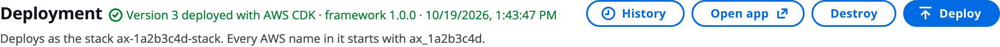

# Clean up

Use this when a build is no longer needed, before you disconnect an account, or when you remove a sandbox. You'll destroy one build from the control plane, delete a build completely, tear down a whole control plane or a stack you deployed yourself with `teardown.sh`, `terraform destroy` or `cdk destroy`, fix a destroy that fails, and check what is left with `leftovers.sh`.

> [!WARNING]
> Destroy cannot be undone. Export the bundle and download any run outputs you need first.

# Destroy a build from the control plane

Destroying removes every AWS resource the build created. The build itself stays in the control plane, and can be deployed again. You need the `destroy` permission.

The Deployment panel, with **Destroy** next to **Deploy**:



1. Click **Destroy** on the Deployment panel.
1. Read the confirmation: every resource the build created is removed with the tool it was deployed with, and its runs go with it.
1. Confirm. The panel shows _Destroying_ until it ends.

Destroy always uses the tool the build was deployed with. What goes with it:

- the execution plane, its runs and their telemetry;
- the user pool of a built-in sign-in, and every login in it;
- custom evaluators the deploy created;
- the build's records in the AWS Agent Registry are deprecated.

The destroy is recorded in the build's deploy history and in your activity log.

## Delete a build completely

Use **Project → Delete this build**. A deployed build is destroyed first, then deleted with every stored version.

## An admin cleans up

An admin can destroy anyone's build from the **Builds** tab of the Admin page: click **Destroy** on its row and type the build's name to confirm. The owner sees in their activity log that the admin did it. See [Users, groups and RBAC](Users_Groups_and_RBAC.md).

# Tear down a control plane or your own stack

A control plane, or a stack you deployed from your laptop, is removed with the IaC tool that deployed it.

With a control plane, first destroy every deployed build from the control plane: each build is its own stack, and the builds bucket (which holds Terraform builds' state) is deleted with the control plane. Export any build you want to keep, because destroying the control plane deletes the builds table.

```bash
terraform destroy                        # leaves Transaction Search and the state bucket
./teardown.sh                            # destroy, then both of those and .terraform (prompts)
FORCE=1 ./teardown.sh                    # no prompt
KEEP_TRANSACTION_SEARCH=1 ./teardown.sh  # leave the account-wide setting alone
cdk destroy                              # CDK; leaves Transaction Search enabled
```

Run the Terraform commands and `teardown.sh` from `orchestrator/terraform`, and `cdk destroy` from `orchestrator/cdk`. `teardown.sh` is best-effort and safe to run again. A redeploy afterwards gets a new execution plane address, so create your login user again.

## Builds table protection

The control plane's builds table has deletion protection on while the control plane runs. A destroy you ask for clears it at the last moment, so each command above finishes in one step. To make a destroy stop at the table instead, keep the protection with `-var keep_builds_table_protected=true` (Terraform) or `-c keepBuildsTableProtected=true` (CDK), then clear it on purpose with `aws dynamodb update-table --table-name <agentName>_builds --no-deletion-protection-enabled`.

# Fix a destroy that fails

| Symptom | Cause | Fix |
|---|---|---|
| CDK: `DELETE_FAILED` on the orchestrator, `NotStabilized` | AgentCore was still draining the runtime | Run the destroy again |
| CDK: `DELETE_FAILED` on a runtime, "Access denied for operation 'AWS::BedrockAgentCore::Runtime'", after a `NotStabilized` retry | AgentCore had already deleted the runtime | Run the destroy again |
| CDK: `DELETE_FAILED` on the UI logs bucket, "bucket not empty" | CloudFront delivered a late access log after the bucket was emptied | Empty the bucket with `aws s3 rm s3://<bucket> --recursive`, then destroy again |
| Terraform: `NotStabilized` on the runtime, then "Invalid for_each argument" on the retry | The first destroy removed the UI build step from state | Run `terraform apply -target=null_resource.ui_build`, then `terraform destroy` |

A destroy started from the control plane handles these cases itself. When it fails, it reads every resource of the build's stack, however many there are, and tries again, up to 3 more times:

- **CDK:** it empties a refilled UI logs bucket, waits for a runtime whose delete timed out (`NotStabilized`), and retries a runtime that failed with "Access denied" once AgentCore confirms it is gone.
- **Terraform:** it waits and retries when a runtime's delete timed out (`NotStabilized`), even when the error names no resource address, and rebuilds the UI build step before each retry.

Any other failure, or the last attempt's, shows on the Deployment panel and in **History**. Fix what it names, then click **Destroy** again.

# Check what is left behind

A failed or interrupted deploy or destroy can leave resources the state no longer knows about. They block the next deploy under the same name. To list them, from the repository root:

```bash
./orchestrator/leftovers.sh <agent_name> [region]
```

- It lists what is still tagged `agentexpress:app = <agent_name>`, so it is safe in a shared account.
- It only reports. It deletes nothing.
- Exit code `10` means something was found; `1` means it could not look.
- It sees only taggable resource types, and a resource deleted moments ago can be listed for a few minutes. The stack's KMS key waits 7 days for deletion and is listed apart.

`teardown.sh` runs it for you. Run it yourself after `cdk destroy`. For a build deployed from the control plane, the agent name is the build's `ax_` id shown on the Deployment panel.

## Log groups

Log groups of the Lambdas the project creates are removed. Log groups it does not create, such as the AgentCore runtime's own, are left behind. To remove them:

```bash
aws logs describe-log-groups \
  --query "logGroups[?contains(logGroupName,'<agent_name>')].logGroupName" --output text \
  | xargs -n1 aws logs delete-log-group --log-group-name
```

# Ask the Assistant

The AgentExpress Assistant can't destroy or delete anything. Use **Destroy** on the Deployment panel, **Project → Delete this build**, or the commands above.

- It can take out parts of the build before you redeploy, for example: "Remove the research agent and the web search tool". The next deploy updates the stack without them.
- **Start over** in the Assistant panel only clears the conversation. The build and its undo stay.

More about what it can do is on [Ask the Assistant](Ask_the_Assistant.md).

# Related pages

- [Deploy a build](Deploying_a_Build.md): the Deployment panel and the history.
- [Set up AWS accounts](AWS_Accounts.md): disconnect an account after its builds are destroyed.
- [Deploy from your laptop](Deploy_from_Your_Laptop.md): stacks you deployed yourself.
- [Troubleshooting](Troubleshooting.md): other deploy and destroy problems.
