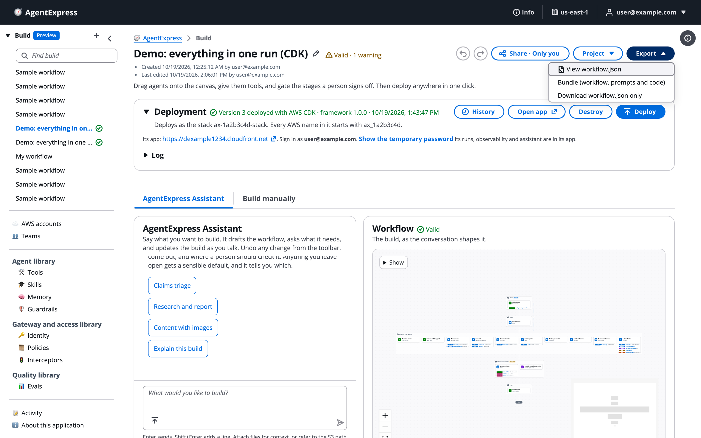

# Export, edit and import

A build can leave the control plane as a file and come back. You'll export a file from the **Export** menu, see what it holds, edit `workflow.json` yourself, and load it back with **Project → Import a file…**, as a new build or into the same one. Use it to keep a copy, review a build in a repository, move a build to another control plane, or make a change faster in a text editor.

# Open the Export menu

The **Export** button sits at the top right of every build page. It opens three choices.

The Export menu open on the example build:



| Choice | What you get | When to use it |
|---|---|---|
| **View workflow.json** | Opens the **workflow.json** tab of **Build manually**. | To read or copy the file the build stands for. |
| **Bundle (workflow, prompts and code)** | One JSON file named after the build, ending `.agentexpress.json`: the workflow, each agent's prompt, and code written in the build. | To keep a full copy, move the build to another control plane, or work on it in a repository or with a coding agent. Greyed out while the build has errors. |
| **Download workflow.json only** | Just the workflow file. | To read it, review it, or put it into a repository that already has the agents. |

A bundle carries no secrets and no documents you uploaded to a knowledge base. After you download a bundle, a message explains what the file holds and that **Deploy** on the build page is the way to run it.

# What is in a bundle

A bundle is one JSON file with these parts:

```json
{ "format": "agentexpress-bundle", "version": 1, "framework": { "version": "1.0.0" },
  "project": { "id": "…", "name": "…", "exportedAt": "…" },
  "workflow": { },
  "prompts":  { "<agent>": { "systemPrompt": "…", "schema": "…" } },
  "toolCode": { "<key>": { "handler.py": "…", "requirements.txt": "…", "events.json": "…" } } }
```

- `workflow` is the build's `workflow.json`.
- `prompts` holds each agent's system prompt and output schema.
- `toolCode` holds code tools written in the build. A code tool may hold only `*.py`, `requirements.txt` and `events.json`.
- The build's test suites travel with it too, but do not deploy.

# Edit the file

Open the downloaded file in any editor and change what you need: an agent's prompt, a step, a tool's settings, a gate.

- Keep `{"library": "<id>"}` entries as they are. They point to shared library items.
- Put no secret in the file. Secrets stay in the control plane.
- Keep the file valid JSON.
- For every key and its allowed values, see [workflow.json settings](Workflow_JSON_Reference.md).

A coding agent can make the edit for you. See [Code bundle and a coding agent](Code_Bundle_and_Coding_Agent.md).

# Import a file

To bring a `workflow.json` or a bundle back into the control plane:

1. Open **Project** and choose **Import a file…**.
1. Choose **As a new build** (this build stays as it is) or **Into this build, replacing it** (same build, same deploys).
1. Click **Choose file…** and pick the file.

The Import a file dialog:


Replacing asks you to confirm, and **Undo** takes it back. A notice says how many agents and stages were loaded. The Problems list then checks the imported build with the same rules as a deploy, so fix any errors before you click **Deploy**.

# Move a build to another control plane

1. On the first control plane, click **Export → Bundle (workflow, prompts and code)**.
1. On the other control plane, create or open a build and use **Project → Import a file…** with **As a new build**.
1. Enter the build's secrets again, and upload any knowledge base documents again. Neither travels in the bundle.

To deploy the bundle from a checkout of the framework instead of a control plane, see [Deploy from your laptop](Deploy_from_Your_Laptop.md).

# Ask the Assistant

The AgentExpress Assistant can't export or import a build. Use the **Export** menu and **Project → Import a file…**.

- It can read a `workflow.json` or a bundle you attach to the chat, as a reference for its own edits. It doesn't load it into the build. For example: "Add the review stages from the attached workflow.json to this build".
- For a change you would otherwise make in a text editor, ask it in plain words instead. It edits the same `workflow.json`.

More requests are on [Ask the Assistant](Ask_the_Assistant.md).

# Related pages

- [The control plane](Builder_Console.md): the build page, Project menu and saving.
- [workflow.json tab](Workflow_JSON_Tab.md): read and edit the file inside the control plane.
- [Code bundle and a coding agent](Code_Bundle_and_Coding_Agent.md): edit a bundle with Kiro.
- [Deploy from your laptop](Deploy_from_Your_Laptop.md): deploy a bundle with CDK or Terraform yourself.
