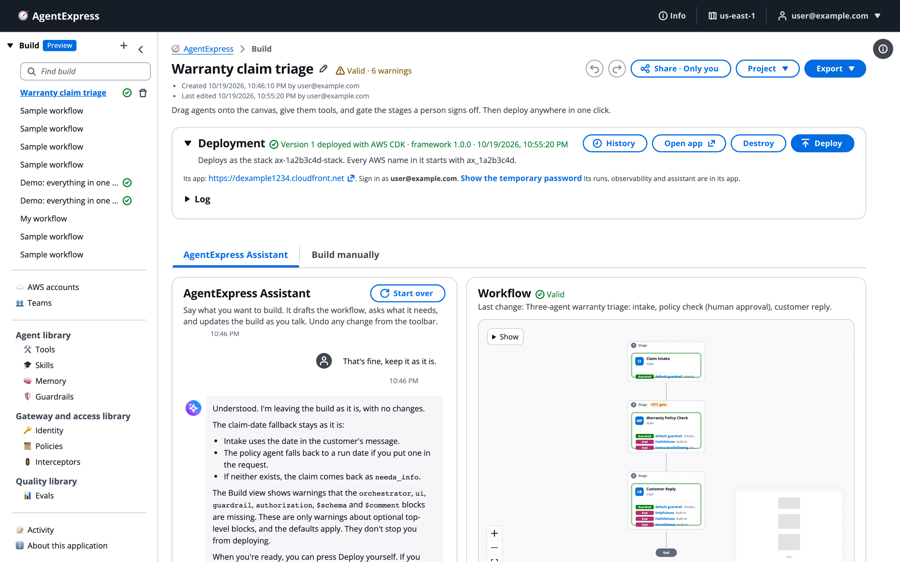
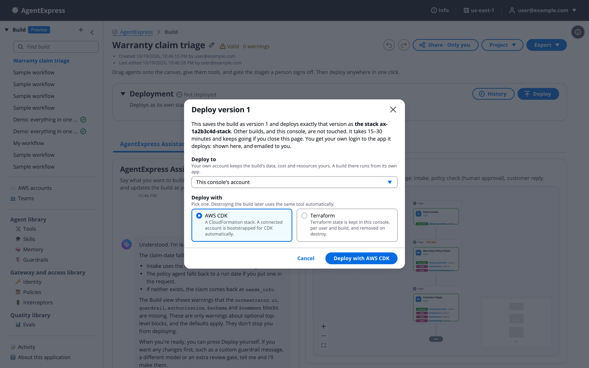
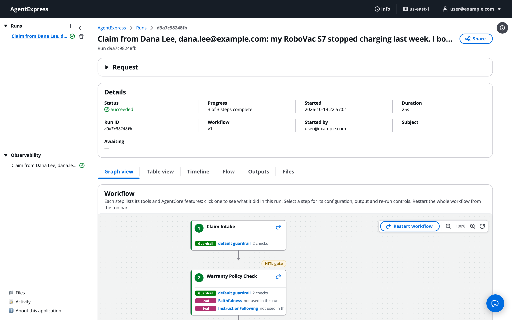
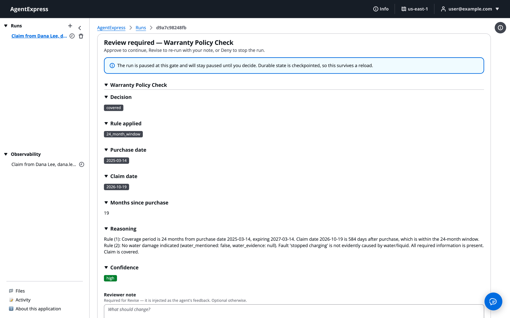

# Your first build and run

New to AgentExpress? Go from an empty build to a finished run in about ten minutes. You describe a workflow to the AgentExpress Assistant, review the draft, deploy it, open its execution plane, start a run and approve a review gate. Each step links to the page that explains it in full. You need a control plane login and the `deploy` permission.

> [!NOTE]
> Every screenshot on this page comes from one build, _Warranty claim triage_: three stages (claim intake, warranty policy check with a person's approval, and the customer reply). The request sample data is invented. You can build the same workflow by typing the request in step 1 below.

# Create a build

1. In the control plane's left pane, click **+** next to **Build**. A new build called _My workflow_ opens.
1. Rename it: click the pencil next to its name, type a name, and press Enter.

Builds save automatically to your account on the control plane, so you can close the page and come back from any browser. More on [The control plane](Builder_Console.md).

# Describe the workflow to the Assistant

The build opens on the **AgentExpress Assistant** tab. The conversation is on the left, and a **Workflow** preview of the build is on the right.

1. In the box that says _What would you like to build?_, type this request, or one of your own:

```
Warranty claims: check the purchase date against the 24-month warranty, check whether water damage is mentioned, have a person approve the decision, and draft the reply to the customer.
```

1. Or click a starting point under the box: **Claims triage**, **Research and report**, **Content with images** or **Explain this build**.
1. Press Enter to send. The reply streams in, and the **Workflow** preview updates as each change lands.

If your request is thin, the Assistant asks up to three questions and proposes an answer to each. Reply **go** to accept them. The choices it made for you are listed under **Defaults used**, and anything only you can supply is listed under **Needs your input**. See [Build with the AgentExpress Assistant](AgentExpress_Assistant.md).

The build after the Assistant drafted it. The conversation on the left shows what it changed, and the **Workflow** preview on the right shows the three stages:



# Review the draft

1. Click **Build manually** to see the canvas. Each stage is a box and each agent is a card that lists its tools, guardrails, memory and other pieces.
1. Click an agent to open its settings on the right: prompt, model, tools and AgentCore features.
1. Check the status next to the build's name. **Valid** means the build can deploy. A red error count means it cannot deploy yet. Click it, then click a problem to jump to it.
1. If a tool needs an API key or a client secret, enter it in the **Secrets** card on the Assistant tab, never in the chat.

The canvas is explained on [Build manually on the canvas](Canvas.md), and agent settings are on [Agents](Agents.md).

# Deploy it

1. On the **Deployment** panel, click **Deploy**.
1. Under **Deploy to**, pick the control plane's own account or an AWS account you connected.
1. Under **Deploy with**, pick **AWS CDK** or **Terraform**. Destroying the build later uses the same tool.
1. Click **Deploy with AWS CDK** (or **Deploy with Terraform**).

The first deploy of a build shows both choices as active, as in this dialog for version 1:



After a build is deployed, the dialog locks **Deploy to** and the tool to where it runs. To move the build or switch tools, click **Destroy** on the Deployment panel first, then deploy again.

The deploy takes 15 to 30 minutes. It runs in the control plane, so you can close the page. The Deployment panel shows progress and a log, and you get a notice when it finishes. Details are on [Deploy a build](Deploying_a_Build.md).

# Open the execution plane and start a run

When the deploy finishes, the Deployment panel shows the execution plane's address and your login.

1. Click **Open app** and sign in. With the built-in sign-in, use **Show the temporary password**.
1. Click **Start run**.
1. Type the request in **Request**. The example uses a sample claim, such as the one in the screenshot. Attach files under **Files (optional)** if the workflow reads them.
1. Click **Start run**.

The Start run dialog in the execution plane. The request is a sample claim about a robot vacuum:


More on [Start a run: prompt, file or trigger](Starting_a_Run.md).

# Follow the run and approve a gate

The run opens and its steps light up as they work. Each card on the graph lists the tools and AgentCore features that step used in this run.

The run graph: Claim Intake, then the Warranty Policy Check with its HITL gate:



1. When the run reaches the **Warranty Policy Check** gate, it pauses and the run page shows **Review required**.
1. Read the decision and the reasoning. Click **Approve** to continue, **Revise** to re-run the step with your note in **Reviewer note**, or **Deny** to stop the run.

The gate screen for this run, showing the decision, the rule applied and the reasoning:



1. When the run finishes, read the result on the **Outputs** tab, and find the cost and every model and tool call on **Observability**.

> [!NOTE]
> On a build you deployed yourself with the built-in sign-in, you are put in every group of its execution plane, so you can decide your own gates.

See [Human in the loop](Human_in_the_Loop.md) and [The run page and its tabs](Run_Page.md).

# Related pages

- [Build with the AgentExpress Assistant](AgentExpress_Assistant.md): get better drafts from the chat
- [Ask the Assistant](Ask_the_Assistant.md): what to ask for each feature
- [Build manually on the canvas](Canvas.md): change the workflow by hand
- [Deploy a build](Deploying_a_Build.md): deploy, history and redeploy
- [The run page and its tabs](Run_Page.md): every view of a run
- [Observability](Observability.md): cost, tokens and traces
