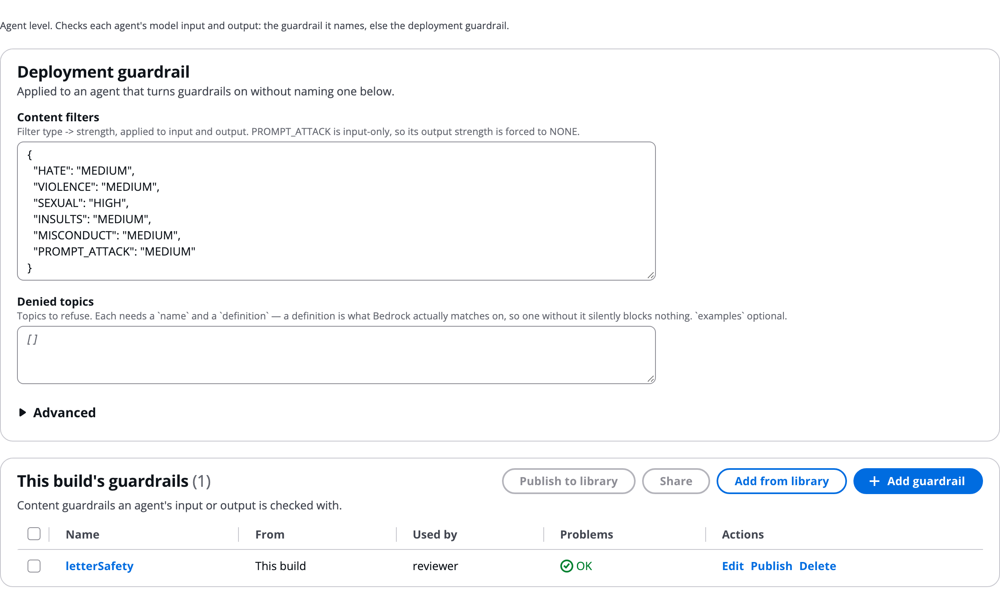

# Guardrails

A guardrail is an Amazon Bedrock guardrail that screens an agent's model input before the model sees it, its output after, or both. Use one on any agent that handles untrusted text or personal data. Here you set the deployment guardrail and named guardrails on the **Guardrails** tab, turn one on for an agent, and see what happens in a run.

# Read the Guardrails tab

The tab's first line says: _Agent level. Checks each agent's model input and output: the guardrail it names, else the deployment guardrail._

The Guardrails tab: the deployment guardrail, and the build's named guardrails below it:



# Set the deployment guardrail

The deployment guardrail applies to an agent that turns guardrails on without naming one.

- **Content filters**: a strength for each filter type (`HATE`, `VIOLENCE`, `SEXUAL`, `INSULTS`, `MISCONDUCT`, `PROMPT_ATTACK`): `NONE`, `LOW`, `MEDIUM` or `HIGH`. `PROMPT_ATTACK` checks input only.
- **Denied topics**: topics to refuse. Each needs a `name` and a `definition` of at most 200 characters, with up to 5 `examples`. Bedrock matches on the definition, so keep it narrow.
- **Advanced**: denied words, managed word lists such as `PROFANITY`, PII entities to `BLOCK` or `ANONYMIZE`, and the messages shown when input or output is blocked.

A guardrail is created only when it enforces something, because Bedrock rejects an empty one.

# Add a named guardrail

**This build's guardrails** holds extra guardrails for agents whose rules differ. Each is its own Bedrock guardrail with the same fields.

1. Click **Add guardrail**.
1. Name it and fill in its filters, topics and PII rules.
1. Pick it on the agents that need it.

The table and its buttons work like every named-item tab; see [Skills](Skills.md). A guardrail kept in the library deploys as its own Bedrock guardrail in each build that uses it.

```json
"guardrails": {
  "strictPii": { "piiEntities": { "EMAIL": "ANONYMIZE", "US_SOCIAL_SECURITY_NUMBER": "BLOCK" } }
}
```

# Turn a guardrail on for an agent

1. Open the agent's settings.
1. Under **AgentCore features**, turn on **Guardrail: check input**, **Guardrail: check output**, or both.
1. Under **Guardrail**, pick a named guardrail, or leave it on **The deployment guardrail**.

New agents start with the build's guardrail on. On the canvas, dropping a guardrail on an agent with no checks turns on both.

In `workflow.json` the agent names the guardrail with `agentcore.guardrails.use`:

```json
"drafter": { "name": "Letter drafter", "maxTokens": 3000,
  "agentcore": { "guardrails": { "use": "strictPii", "output": true } } }
```

Guardrails also screen the call an A2A agent receives and returns, because the call is wrapped in your own container. Text guardrails do not inspect images.

## Use a Bedrock guardrail you already have

For one agent whose content rules really differ, such as a medical or legal stage in a general workflow, you can name an existing Bedrock guardrail instead of the deployment's:

- Set `agentcore.guardrails.guardrailId` to its ID, in `workflow.json` or by asking the Assistant. The **Guardrail** picker lists only the deployment guardrail and named ones.
- Turn on **Guardrail: check input** or **Guardrail: check output** as usual. The card says _existing guardrail_.
- Use a named guardrail (`use`) or an ID, not both: both is an error in Problems.
- The ID belongs to one AWS account, so the build then works only there. A named guardrail deploys with the build in any account.

```json
"medicalReview": { "name": "Medical review",
  "agentcore": { "guardrails": { "guardrailId": "<your guardrail ID>", "input": true, "output": true } } }
```

# What happens in a run

- **Anonymize:** the agent carries on with the masked text. The timeline says the guardrail masked sensitive information.
- **Block:** the step stops, and the timeline names what blocked it, for example "denied topic LegalAdvice" or "content filter INSULTS". The run page says why it stopped.
- On the run's graph, the **Guardrail** row shows its checks. On the Flow, "Guardrail checked input: passed".
- Analytics warns about agents no guardrail screens. See [Analytics](Analytics.md).

> [!WARNING]
> A guardrail's PII filters are a control, not a compliance programme. Meeting HIPAA, PCI DSS or GDPR obligations is your responsibility under the AWS shared responsibility model. Replace any sample guardrail terms before real use.

# Ask the Assistant

The AgentExpress Assistant can set the deployment guardrail (content filters, denied topics, words, PII rules, blocked messages), add named guardrails, turn input and output checks on per agent, and point one agent at a Bedrock guardrail you already have. It keeps each denied topic within the Bedrock limits. Requests you can paste:

- "Add a guardrail that blocks prompt attacks and masks email addresses on every agent"
- "Deny the topic legal advice on the letter writer's output"
- "Use our existing Bedrock guardrail &lt;its ID> for the medical review agent only"

* With **Review changes** on **Auto**, any guardrail change is checked by a second model before it is saved.
* Organisation guardrails such as a permissions boundary or a web application firewall are set when the control plane is deployed, not in a build. See [Sign-in and security](Security.md).
* Publishing a guardrail to the library is done on the Guardrails tab.

More requests are on [Ask the Assistant](Ask_the_Assistant.md).

# Related pages

- [Agents](Agents.md): the AgentCore features of an agent
- [Library](Library.md): a company standard guardrail for every build
- [Policies (Cedar)](Policies_and_Cedar.md): rules on tool calls rather than model text
- [Identity](Identity.md): the next configuration tab
