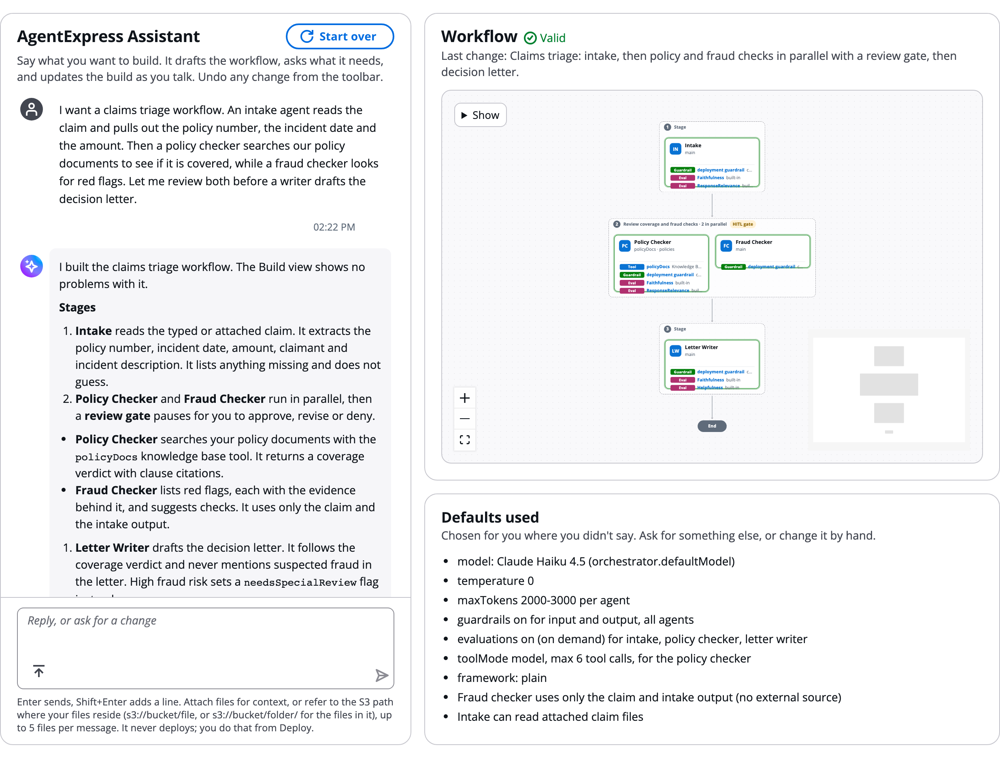
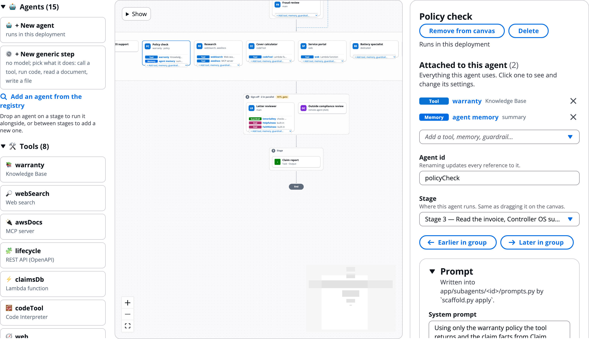
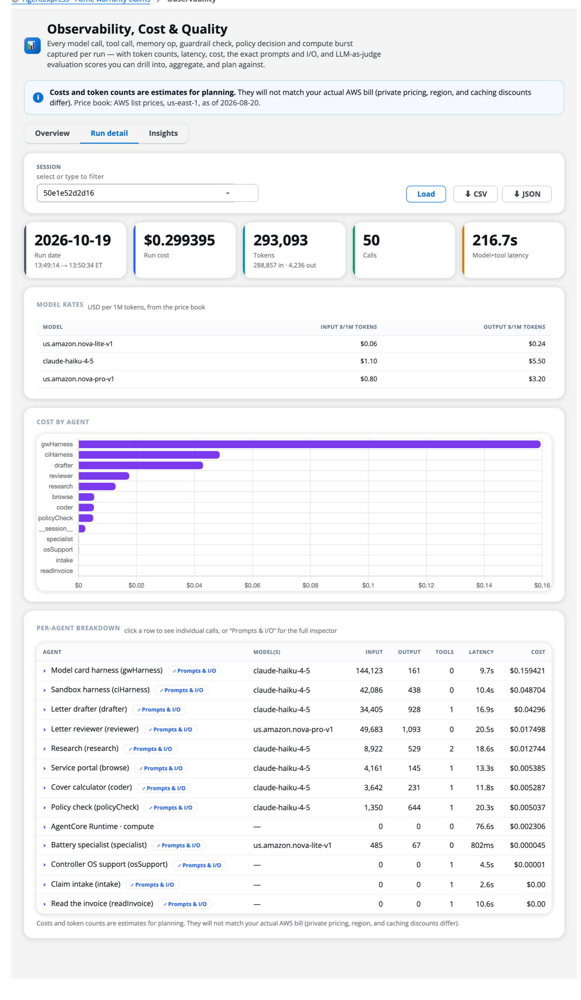

# AgentExpress

Describe your use case. Watch the multi-agent system come together visually.

Questions or feedback? Open an issue on [GitHub Issues](https://github.com/aws-samples/sample-aiml-solution-labs/issues).

- **Deploy your own**: [Quick start](https://github.com/aws-samples/sample-aiml-solution-labs/tree/main/workshop/AgentExpress#quick-start)
- **Get the code**: [aws-samples on GitHub](https://github.com/aws-samples/sample-aiml-solution-labs/tree/main/workshop/AgentExpress)
- **Take the workshop**: [Hands-on labs](https://catalog.workshops.aws/workshops/47a81974-0422-4d93-a72d-be73a752a182/en-US)
- **Watch the demo**: [10-minute walkthrough](https://github.com/aws-samples/sample-aiml-solution-labs/tree/main/workshop/AgentExpress#watch-the-demo)
- **Ask a question**: [GitHub Issues](https://github.com/aws-samples/sample-aiml-solution-labs/issues)

AgentExpress is a configuration-driven multi-agent orchestrator built on LangGraph and deployed on Amazon Bedrock AgentCore. One file, `workflow.json`, declares the agents, how they connect, their tools, the review gates a person signs off, who may do what, and the AgentCore features each agent uses. You rarely edit that file by hand: the control plane writes it for you, from a chat with the **AgentExpress Assistant** or from a drag-and-drop canvas, and deploys it.

The [index of this guide](README.md) follows the order you work in: design, build, configure, deploy, run, observe, evaluate and refine.

# Watch the demo

A 10-minute walkthrough with one workflow, Blog Post Studio, from start to finish:

- Build it by chat with the AgentExpress Assistant, then refine it on the canvas.
- Deploy it to an AWS account.
- Run it, approve its review gates, and see what every agent did and cost.

The video plays in the [Watch the demo](https://github.com/aws-samples/sample-aiml-solution-labs/tree/main/workshop/AgentExpress#watch-the-demo) section of the code repository's README.

# What is AgentExpress

AgentExpress has two parts:

- **Control plane:** where you design, configure, share and deploy workflows.
- **Execution plane:** each deployed workflow gets its own. People use it to:
  - start runs
  - approve the steps a person must sign off
  - see what every agent did and what it cost

More in [Control plane and execution plane](Architecture.md) and [The lifecycle](Lifecycle.md).

# Who it is for

| If you | Start with |
|---|---|
| Are new to AgentExpress and want to try it | [Sign in and find your way](Getting_Started.md), then [Your first build and run](First_Build_and_Run.md) |
| Want to describe a process and get a workflow | [Build with the AgentExpress Assistant](AgentExpress_Assistant.md), then [Ask the Assistant](Ask_the_Assistant.md) for what to ask per feature |
| Design workflows for a team or a customer | [Control plane and execution plane](Architecture.md), [Build manually on the canvas](Canvas.md) |
| Connect agents to data and systems | [Add tools and connectors](Adding_Tools.md), [Tool types in depth](Tool_Types.md) |
| Run workflows and approve their steps | [Start a run](Starting_a_Run.md), [Human in the loop](Human_in_the_Loop.md) |
| Operate a deployed workflow | [Observability](Observability.md), [Analytics](Analytics.md), [Cost and spend limits](Cost_and_Limits.md) |
| Prefer to work in code | [Export, edit and import](Export_and_Import.md), [Code bundle and a coding agent](Code_Bundle_and_Coding_Agent.md) |
| Manage who can do what | [Users, groups and RBAC](Users_Groups_and_RBAC.md), [Teams and workspaces](Teams.md) |

# What it looks like

## Control plane

**Describe it to the AgentExpress Assistant.** You say what you want in plain English. The Assistant drafts the agents, stages, tools and review gates, shows the workflow as it builds it, and lists every default it chose.

**Or build it on the canvas.** Drag agents onto stages, and tools and AgentCore features onto agents. Click any agent to configure it in the panel on the right.

## Execution plane

**Follow every run step by step.** A run shows every step, numbered, with the tools, guardrail and memory it used. Review gates pause the run until a person approves.

## Observability

**See what every run cost and why.** The execution plane records every model call, tool call, guardrail check and policy decision, with tokens, latency and estimated cost per run and per agent.

# How this manual is organized

| Step | Section | Covers |
|---|---|---|
| Try | [Getting started](Getting_Started.md) | Signing in, a tour of the control plane, a first build and run in ten minutes |
| Understand | [Design](Architecture.md) | Control plane and execution plane, the lifecycle, concepts and a glossary |
| Build | [Build](AgentExpress_Assistant.md) | The AgentExpress Assistant, the control plane, canvas, stages and steps, agents, tools |
| Configure | [Configure](Tools_and_Gateway.md) | Each control plane tab with the AgentCore feature behind it |
| Go further | [Advanced configuration](Runtimes.md) | Runtimes, models and routing, every tool type, workflow.json settings |
| Work together | [Collaborate](Library.md) | Library, sharing a build, AWS Agent Registry |
| Control access | [Users and access](Users_Groups_and_RBAC.md) | Users, groups, RBAC, admins, teams, sign-in and security |
| Code | [Work in code](Export_and_Import.md) | Export and import, the code bundle, coding agents, deploying from your laptop |
| Ship | [Deploy](AWS_Accounts.md) | AWS accounts, deploying, opening the execution plane, cleaning up |
| Run | [Execute](Execution_Plane.md) | Starting runs by prompt, file or trigger; the run page; human in the loop; re-runs; chat; sharing |
| Watch | [Observe](Observability.md) | Traces, prompts and I/O, cost, export to Langfuse, Datadog and others |
| Operate | [Monitor and operate](Analytics.md) | Analytics, activity, memory records, files, cost and limits |
| Improve | [Evaluate and refine](Evaluations.md) | Evaluations, test suites, live config, the next version |
| Help | [FAQ](FAQ.md) | FAQ, troubleshooting, what's new |
