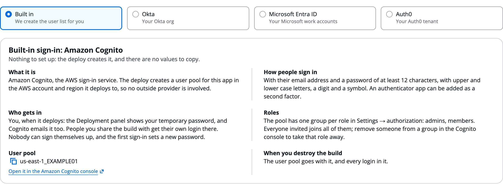

# Identity

The **Identity** tab covers two things: who may sign in to the execution plane this build deploys, and the credentials tools and agents use to reach outside APIs. Behind the second is AgentCore Identity, which keeps each OAuth client or API key as a credential provider so agents never see a secret. Here you pick the sign-in provider on **Sign-in**, review and share tool logins on **Tool access**, and let an agent call an API with its own identity.

# Choose how people sign in

On the **Sign-in** inner tab, pick where people sign in to the execution plane:

- **Built in**: Amazon Cognito. The deploy creates a user pool for this execution plane. Nothing to set up.
- **Okta**, **Microsoft Entra ID** or **Auth0**: your own provider. The tab shows the two values to copy from it, and after a deploy the execution plane's address to register there.

The Sign-in tab with **Built in** chosen:



## Built-in sign-in

With **Built in**, the tab explains:

- **How people sign in**: email and a password of at least 12 characters, with upper and lower case letters, a digit and a symbol. An authenticator application can be added as a second factor.
- **Who gets in**: you, when it deploys, and the people you share the build with. Nobody can sign themselves up, and the first sign-in sets a new password.
- **Roles**: one group per role named in **Settings → authorization**. Everyone invited joins all of them; remove someone from a group in the Cognito console to take that role away.
- **User pool**: its ID and a link to it in the Amazon Cognito console, once deployed.
- **When you destroy the build**: the user pool goes with it, and every login in it.

## Your own provider

With Okta, Entra ID or Auth0, roles come from the provider's groups (Okta), application roles (Entra ID) or a roles claim added by a post-login Action (Auth0, set under **Roles claim**). Who may do what is set on the [Settings tab](Settings.md) and explained on [Users, groups and RBAC](Users_Groups_and_RBAC.md).

# Review how each tool connects

The **Tool access** inner tab lists every tool and how it connects, with **Edit** to change each one. How a tool connects is explained on [Add tools and connectors](Adding_Tools.md).

# Save a login several tools share

Below the tool list are the build's saved logins: named identities. Each is one of two types:

- **OAuth2 client credentials**: a client ID, scopes, and a discovery or token URL. The client secret goes in the build's secrets.
- **API key**: the key goes in the build's secrets.

Several tools can share one identity, so rotating its secret here updates every tool that uses it. The table works like every named-item tab; see [Skills](Skills.md).

```json
"identities": {
  "crmClient": { "type": "oauth2", "clientId": "<client id>", "scopes": ["read"],
                 "tokenUrl": "https://auth.example.com/oauth2/token" }
},
"tools": { "crm": { "type": "openapi", "schemaS3Uri": "s3://amzn-s3-demo-bucket/crm.yaml", "identity": "crmClient" } }
```

Each named identity becomes an AgentCore Identity credential provider at deploy.

# Enter secrets

The **Secrets** section takes each identity's API key or OAuth client secret.

- Secrets are typed into write-only fields, stored encrypted with the build, vaulted in AgentCore Identity at deploy, and never shown again.
- Secrets never go in `workflow.json`, and a bundle export never carries them.
- An identity holds no secret in its definition, so each build that uses a shared library identity enters its own.

# Let an agent call an API itself

Most agents reach APIs through tools, and the Gateway signs in for them. An agent whose own code calls an API directly uses **Outbound identity (calls an API directly)** in its **AgentCore features** (`agentcore.identity.outbound`). Its code fetches a token with `ctx.get_identity_token`.

Identities are also used by a harness agent on another model provider, as its API key, and by an A2A agent with `auth: "oauth2"`. See [Runtimes](Runtimes.md).

# Ask the Assistant

The AgentExpress Assistant can pick the sign-in provider and its settings, add saved logins (OAuth2 client credentials or API key), have a tool sign in with one, and give an agent an outbound identity. It can also explain how each tool connects. Requests you can paste:

- "Sign people in with Okta: domain &lt;your Okta domain>, client ID &lt;the client ID>"
- "Add an OAuth2 identity crmClient with the token URL &lt;the token URL> and scope read, and use it on the crm tool"
- "Let the reporting agent call the analytics API itself with the analyticsClient identity"

What you do yourself:

- **Secret values**: the Assistant never takes them in the chat. It lists what is missing in the **Secrets** card; type them there or under **Enter secrets**.
- **Callback and sign-in addresses** are registered at your provider, after a deploy.
- **Users and groups** are managed in the user pool or your provider, and on the **Admin** page.

With **Review changes** on **Auto**, sign-in and identity changes are checked by a second model before they are saved. More requests are on [Ask the Assistant](Ask_the_Assistant.md).

# Related pages

- [Add tools and connectors](Adding_Tools.md): How it connects, per tool
- [Users, groups and RBAC](Users_Groups_and_RBAC.md): groups and permissions in the execution plane
- [Sign-in and security](Security.md): sign-in providers and what stays private
- [Policies (Cedar)](Policies_and_Cedar.md): the next configuration tab
