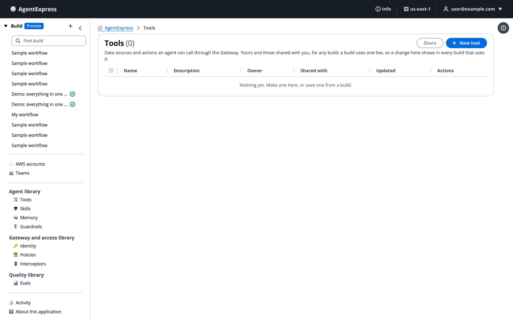
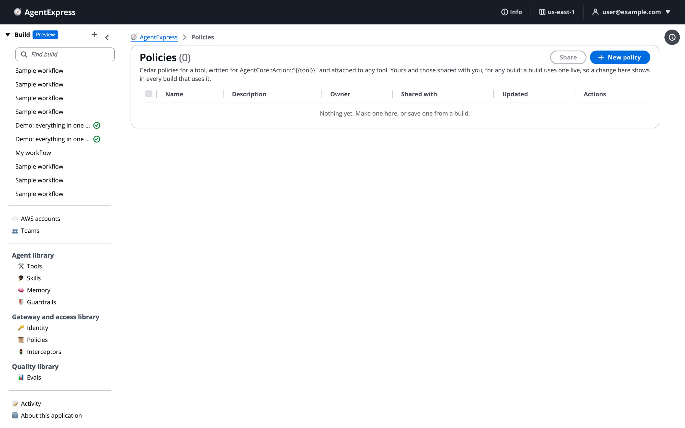

# Library

The library holds pieces you can use in any build: tools, skills, memories, guardrails, identities, Cedar policies, interceptors and evaluators. Make a piece once, share it with colleagues, and every build that uses it stays in step. Use it for anything several builds should do the same way, such as a company guardrail or a shared knowledge base. The library pages are in the control plane's left pane.

# Find the library pages

The library is grouped the way the control plane tabs are:

| Group | Pages | Matching build tabs |
|---|---|---|
| **Agent library** | **Tools**, **Skills**, **Memory**, **Guardrails** | [Tools](Tools_and_Gateway.md), [Skills](Skills.md), [Memory](Memory.md), [Guardrails](Guardrails.md) |
| **Gateway and access library** | **Identity**, **Policies**, **Interceptors** | [Identity](Identity.md), [Policies](Policies_and_Cedar.md), [Interceptors](Interceptors.md) |
| **Quality library** | **Evals** | [Evaluations](Evaluations.md) |

The Tools library page, empty, with **Share** and **New tool**:

Every library page has the same layout: a table of items that are yours or shared with you, with **Share** and **New** buttons at the top. The columns are **Name**, **Description**, **Owner**, **Shared with**, **Updated** and **Actions** (**Edit** and **Delete**; interceptors have **View**).

# Know how library items behave

- **Private until shared.** A new item is yours alone. Share it to let others use it.
- **Used live.** A build that uses a library item does not copy it. Change the item and every build that uses it shows the change at once. A deployed build picks the change up on its next deploy.
- **Interceptors are the exception.** A build that adds a library interceptor takes a copy.
- **Secrets stay with each build.** A library identity holds no secret. Each build enters its own API key or client secret.
- **Deleting is safe.** Deleting an item from the library leaves every build that used it with its own copy.

The AgentExpress Assistant sees your library and reuses an item that fits instead of writing a new one. It never edits a library item a build uses.

# Make and share an item

To make an item on a library page:

1. Open the page in the left pane, for example **Tools**.
1. Click **New tool** (or **New skill**, **New guardrail**, and so on).
1. Give it a name and description, fill in its definition, and click **Save**.

Interceptors are not made on the library page; publish one from a build's Interceptors tab.

To share items:

1. Tick them in the table.
1. Click **Share (n)**.
1. Add **People** (email addresses, one per line), **Groups** (defined by an admin on the Admin page), or turn on **Everyone**.
1. Click **Save**.

# Move items between a build and the library

On a build's tabs:

- **Publish** on one row, or **Publish to library (n)** for the ticked rows, copies the build's items to your library. The build then uses the library item.
- **Share (n)** publishes the ticked rows first, then opens the share dialog.
- **Add from library** puts a library item into the build, live.
- **Make a copy for this build** on a library row gives the build its own copy, so later library edits no longer reach it.
- **Unpublish** takes the item out of the library. Every build that used it keeps its own copy.

The **From** column on a build's tab says where each item comes from: _This build_, _Library · yours_, _Library_ with the owner's email, or _Missing from the library_.

# Choose what to keep in the library

| Page | Keep here | Good to know |
|---|---|---|
| **Tools** | A knowledge base, internal API or MCP server several builds call | A new tool starts as an MCP server. Each build sets the tool's secrets itself. |
| **Skills** | A house style, checklist or procedure | An agent picks it in its **Skills** setting, beside the build's own. |
| **Memory** | A way of remembering several builds share | A new memory starts with the semantic strategy, 30 days, per user. Each build deploys its own AgentCore Memory, so builds do not read each other's records. |
| **Guardrails** | A company standard: denied topics, words, PII handling | A new guardrail starts with the hate and prompt-attack filters at `HIGH`. Each build deploys it as its own Bedrock guardrail. |
| **Identity** | An OAuth client or API key several builds use | Publishing or sharing an identity never shares a secret. |
| **Policies** | A rule for many tools in many builds | Written for whichever tool it is attached to. A new policy starts as a `forbid` on all of a tool's operations: add a condition, or it blocks every call. |
| **Interceptors** | Gateway interceptors with their code | **View** shows the description, templates and `handler.py`. |
| **Evals** | A quality bar you score in several builds | Each build that uses it creates it in AgentCore on deploy. |

The Policies library page. In a library policy, the action names the tool with a placeholder the build fills in for each tool the policy is attached to:

# Ask the Assistant

In a build, the AgentExpress Assistant can add your library tools, skills, memories, guardrails, identities, policies and evaluators, live, and use them on agents. It sees the items that are yours or shared with you. Requests you can paste:

- "Use the company guardrail from my library on every agent, for input and output"
- "Add the shared policy documents knowledge base from the library to the research agent"
- "Write this build its own copy of the crmLookup tool, so I can change it here"

* It doesn't see library interceptors or saved export setups. Add those on the Interceptors tab and in the **Export** section of the Settings tab.
* It can't make, edit, share, publish or unpublish a library item. Do that on the library pages, or with the row actions on a build's tabs.

More requests are on [Ask the Assistant](Ask_the_Assistant.md).

# Related pages

- [Share a build](Sharing_a_Build.md): share the whole build instead of pieces
- [AWS Agent Registry](Agent_Registry.md): your organisation's approved records
- [Teams and workspaces](Teams.md): share with a fixed group of people
- [Skills](Skills.md): the table layout every named-item tab shares
