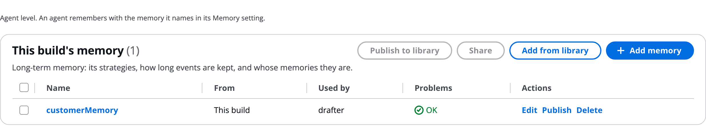

# Memory

AgentExpress uses AgentCore Memory in two ways: short-term checkpoints that let a run pause and resume, and long-term memory that lets an agent remember insights across runs. Here you define long-term memories on the **Memory** tab and give an agent one. Use long-term memory when an agent should learn from earlier runs, for example a customer's preferences.

# Know the two kinds of memory

**Short-term memory: checkpoints.** Every deployment keeps each run's state in AgentCore Memory as a checkpoint. That is what lets a run wait at a gate for days and resume, and re-run from any step. It is always on, with no setting.

**Long-term memory.** An agent with long-term memory recalls past insights into its prompt before it runs, and stores new ones after. You define it on the **Memory** tab and turn it on per agent.

# Read the Memory tab

The tab's first line says: _Agent level. An agent remembers with the memory it names in its Memory setting._

The Memory tab with one memory:



The table and its buttons work like every named-item tab; see [Skills](Skills.md).

# Define a memory

Click **Add memory** and set:

- **Strategies**: what is extracted from each stored turn.
- **Expiry days**: how long events are kept, 3 to 365.
- **Scope**: whose memories they are.
- A description.

| Strategy | Keeps |
|---|---|
| `semantic` | Discrete insights, across runs |
| `summary` | A running summary of a run |
| `userPreference` | The requester's stated preferences |
| `episodic` | A record of each run, with reflections across runs |
| Custom | A built-in strategy that follows your own extraction instructions and model |

| Scope | Whose memories |
|---|---|
| `user` (default) | Each person's own. One user's runs never feed another's. |
| `subject` | Shared per subject, the optional name a person gives on **Start run** |
| `agent` | Everyone who runs the agent |
| `run` | One run only |

Each strategy is a model call per stored turn, so extra strategies are created only when some agent uses them.

# Give an agent memory

1. Open the agent's settings.
1. Under **AgentCore features**, turn on **Long-term memory**.
1. Pick a memory from the **Memory** tab, or drag the memory from the palette onto the agent.

Agents that name the same memory share it, within its scope. A harness agent can keep its conversation in one of the build's memories instead; use that or the agent's memory switch, not both.

In `workflow.json`, a named memory is in `memories` and an agent uses it with `agentcore.memory.use`:

```json
"memories": { "customerMemory": { "strategies": ["semantic"], "scope": "user", "expiryDays": 30 } },
"agents": { "drafter": { "name": "Letter drafter", "maxTokens": 3000,
  "agentcore": { "memory": { "use": "customerMemory" } } } }
```

# See memory in a run

- On the run's graph, the **Memory** row shows "recall, store". The Flow shows "Recalled from memory" and "Saved to memory".
- Recalled insights are labelled as unverified recollections, never evidence.
- Admins browse, search and delete stored records on the execution plane's **Memory records** page. See [Memory records](Memory_Records.md).

# Ask the Assistant

The AgentExpress Assistant can define a memory, with its strategies (including a custom one with your own extraction instructions), expiry and scope, give it to agents, and set a harness agent's memory. Requests you can paste:

- "Add a memory customerMemory that keeps each requester's preferences for 30 days, and give it to the drafter"
- "Share customerMemory per subject instead of per user"
- "Add a custom memory strategy that extracts only the products a customer complained about"

* Short-term checkpoints are always on, so there is nothing to ask for. The Assistant can explain how they work.
* Stored records are browsed and deleted in the execution plane, on **Memory records** (admins).

More requests are on [Ask the Assistant](Ask_the_Assistant.md).

# Related pages

- [Agents](Agents.md): the AgentCore features of an agent
- [Start a run: prompt, file or trigger](Starting_a_Run.md): the Subject field
- [Memory records](Memory_Records.md): what agents remembered
- [Guardrails](Guardrails.md): the next configuration tab
