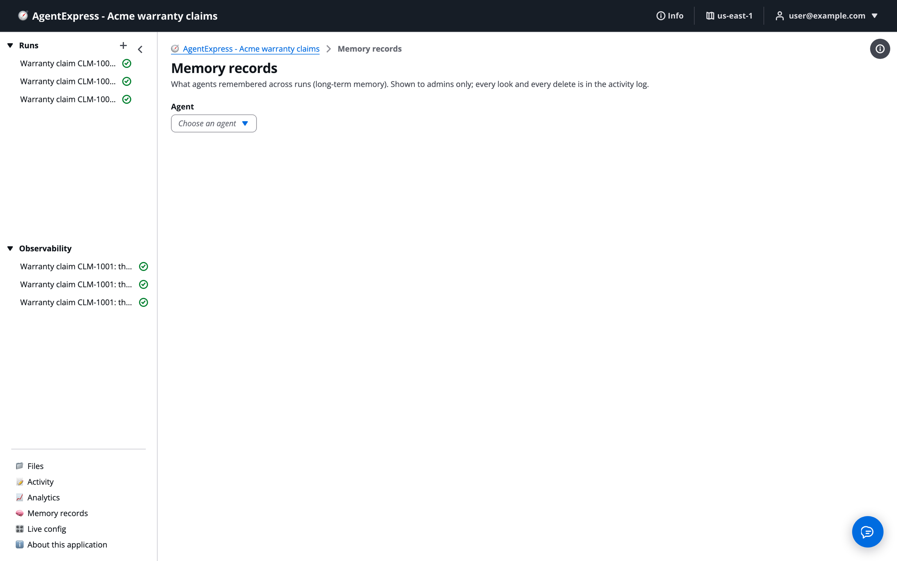

# Memory records

**Memory records** shows what agents remembered across runs: the long-term memory records AgentCore extracted from what agents stored. Use it to check what an agent has learned, to search it, and to delete a wrong or unwanted record. The page is for admins.

For how an agent gets long-term memory, see [Memory](Memory.md).

# Open the Memory records page

Click **Memory records** in the execution plane's left pane. It appears only for people in a group granted the `admin` action. There is nothing to turn on, and the page makes no AWS call until someone opens it.

The Memory records page, before an agent is picked:

If the execution plane has no long-term memory, the page says so.

# Browse an agent's records

1. Under **Agent**, choose an agent. Only agents with long-term memory are listed.
1. Under **Namespace**, choose one. Each shows its kind and number of records.
1. Read the records: **Record** (the text), **Created**, and **Strategy** (which memory strategy wrote it).
1. Click **Load more** to read the next page.

## What a namespace is

A namespace is one actor: the agent plus a user digest, a subject or a run, depending on the agent's memory scope (`agentcore.memory.scope`). An actor is shown as a user digest, not an email.

| Scope | Whose memories a namespace holds |
|---|---|
| `user` (default) | Each user's own: a digest of the user, and the subject when the run has one |
| `subject` | Shared by every run on the same subject |
| `agent` | Shared by everyone who runs the agent |
| `run` | One run only |

A namespace is keyed by agent and actor, not by the person signed in, and some scopes are shared by everyone who runs the agent. That is why the page is for admins only, and why people cannot browse "their own" memory.

# Search a namespace

1. Type in **Search this namespace**, up to 1,000 characters.
1. Click **Search**. The records are ranked against your text, each with a **Score**.
1. Click **Clear search** to go back to the list.

# Delete a record

1. Click the record's delete icon.
1. Check the record named in **Delete memory record**.
1. Click **Delete**.

What delete does:

- It removes that one record for good.
- It does not remove the stored turn the record was extracted from. That stays until the memory's event expiry.
- A later run that stores the same thing can create the record again. Fix what produced a wrong fact as well as deleting it, for example the agent's prompt or the data it read.

# What is logged

Every look and every delete is in the Activity log, with the agent and namespace. The search text and the deleted record's text are not logged. See [Activity](Activity.md).

To make the page read-only, a deployer can remove the delete permission from the execution plane's API role. The statement is named `MemoryInspectorDelete` in both IaC paths.

# Ask the Assistant

In the control plane, the AgentExpress Assistant can give agents long-term memory and change what it keeps, which decides what shows on this page. Requests you can paste:

- "Give the letter agent long-term memory of each customer's preferences, shared by every run on the same subject"
- "Add a custom memory strategy to the triage agent that keeps only claim decisions and their reasons"
- "Keep the triage memory's stored turns for 90 days"
- "Stop the research agent from using long-term memory"

What it can't do here:

- Browse, search or delete records. Admins do that on this page.
- Deploy. Memory changes reach runs once you choose **Deploy**.

All requests by feature: [Ask the Assistant](Ask_the_Assistant.md).

# Related pages

- [Memory](Memory.md): short-term and long-term memory, scopes and strategies.
- [Start a run: prompt, file or trigger](Starting_a_Run.md): the Subject that scopes memory.
- [Activity](Activity.md): the log of looks and deletes.
- [Live config](Live_Config.md): fix a prompt that produced a wrong fact.
