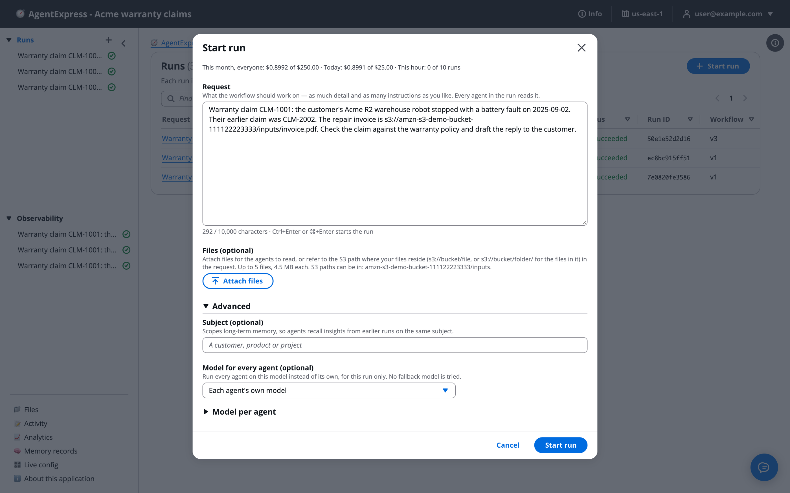

# Models, routing and LiteLLM

Each agent can name its own model, and three settings choose which model answers a given call: routing rules, fallbacks, and a per-run override. Use this when one model does not fit every request or you need another provider. You'll pick a model, set those three, reach non-Bedrock models through a LiteLLM proxy, and make agents that draw or read images. Prompt caching has its own page.

# Pick a model

Each `main`, `dedicated` and `harness` agent can name its own `model`. An agent without one uses `orchestrator.defaultModel` (**Default model** on the [Settings tab](Settings.md)); the deployment's own model setting overrides that, and a Claude Haiku model is the framework default.

- The model picker in the agent settings lists the Bedrock text models your account can call, read live from Bedrock.
- It offers only models that can do what the agent asks: image input for `vision`, tool calling for `toolMode: "model"`. A mismatch shows in Problems.
- With a LiteLLM proxy set up, the picker also lists the proxy's models, marked "via LiteLLM".

| Key | Meaning |
|---|---|
| `maxTokens` | Required. The output budget per model call. Too low and the output is cut mid-JSON. Raise it first when a step says the model returned no parseable JSON. |
| `temperature` | Optional, default 0 |
| `topP`, `stopSequences` | Optional. Several Claude models take temperature or top P, not both. Up to 4 stop sequences. |

A cross-Region inference profile prefix (`us.`, `eu.`, `apac.`) is moved to the deployment Region's geography. A model call may take up to 300 seconds, with one retry.

# Route calls by rule

Routing rules are checked on every model call. The first match wins; with no match the agent's own model answers. In the control plane, use **Pick the model by rule** in the agent settings panel. Up to 10 rules per agent.

- **The input is over (tokens)** (`inputTokensOver`): the call's system and user text is over that many tokens, estimated at 4 characters per token. Attached files and images are not counted.
- **The request or subject matches** (`matches`): a regular expression, case-insensitive, searched in the run's request and subject.
- **Use model**: the model to call when the rule matches.

# Add fallback models

**Fallback models** (`models.fallback`): up to 3 models tried in order when the model is busy or not ready (Bedrock throttling, service unavailable or model not ready; HTTP 429 or 503 from a LiteLLM proxy). Bedrock's own retry runs first. Any other error, such as validation, access, a timeout or a guardrail refusal, fails the step.

```json
"models": {
  "route": [{ "model": "us.amazon.nova-pro-v1:0", "matches": "battery" }],
  "fallback": ["us.amazon.nova-lite-v1:0"]
}
```

Routing and fallbacks add no resource or permission: the runtimes may already call any Bedrock foundation model and inference profile in the Region and account.

# Let people pick a model per run

A builder lists up to 20 models in `orchestrator.models.overrides` (**Models** on the Settings tab) and grants the `override` action to a group. People in that group then see **Model for every agent** and **Model per agent** under **Advanced** on **Start run**.

Start run with **Advanced** open, showing **Subject (optional)**, **Model for every agent (optional)** and **Model per agent**:



The pick applies to that run only, through every gate and re-run, with no routing and no fallback. The run page shows **Model override**.

The run's timeline says when a route or a fallback is used, and each call's telemetry records the model and why it was chosen: route N, fallback N or override. Harness agents, A2A agents and task steps keep their own models.

# Cache prompts per agent

Prompt caching makes repeated prompts cost less: Bedrock reuses the start of a request that repeats from call to call. You turn it on per agent; see [Prompt caching](Prompt_Caching.md).

# Use LiteLLM models

If you run a LiteLLM proxy, an agent can use any model the proxy serves, such as OpenAI, Gemini or Mistral models. Set the agent's model to `litellm/<name>`, where the name is what the proxy lists. Every other agent stays on Bedrock.

- **Setup:** the deployment needs the proxy's https base URL on a public address and the ARN of a Secrets Manager secret holding the proxy's virtual key, given together. A control plane passes its own two settings to every build it deploys. Give the key only the models your agents use.
- **What still works:** guardrails, long-term memory, skills, `model` tool mode, `vision`, run files, truncation warnings, Stop, and telemetry. Evaluations can score the agent; the judge runs on Bedrock.
- **Limits:** `orchestrator.defaultModel`, evaluator judge models and the AgentExpress Assistant stay on Bedrock. Cost comes from the proxy's cost header; without it the cost shows as \$0. Pick a proxy model that reads images or calls tools when the agent needs it, because the picker cannot tell.
- A harness agent does not use this proxy. It has its own LiteLLM provider setting.

# Draw and read images

**Agents that draw.** Set `"output": "image"` on an agent. Its model writes an image brief and a Stability image model on Bedrock renders it. The images are shown to the reviewer at the gate and priced per image. `image` settings: `model`, `aspectRatio` (default 1:1), `outputFormat` (png or jpeg), `seed` and `negativePrompt`. A deployment outside a US geography is refused unless the agent sets `image.allowCrossRegion: true`. Images load only for the run's owner, so they do not show on a shared link.

**Agents that read images.** A later agent reads earlier agents' images with `vision`:

```json
"vision": { "from": ["poster"], "maxImages": 4 }
```

Pick a model that reads images. Only this run's images are read, up to `maxImages` (default 4, at most 20). Each agent in `from` must run in an earlier stage.

Separately, `attachments: true` lets an agent's model read the files a run is started with. See [Start a run: prompt, file or trigger](Starting_a_Run.md).

# Ask the Assistant

The AgentExpress Assistant can set each agent's model and its settings, the **Default model**, routing rules, fallbacks, the models people may pick per run and who may pick them, and image and vision agents. It picks only from the Bedrock models this account can use, and only ones that can do what the agent asks. Requests you can paste:

- "Use Amazon Nova Pro for the summary agent, with temperature 0.2 and 3,000 max tokens"
- "Route requests that mention battery to Nova Pro, and fall back to Nova Lite when the model is busy"
- "Let the analysts group pick a model per run, from Nova Pro and Nova Lite"
- "Make the poster agent draw a 16:9 PNG, and have the checker agent look at its images"

* It can't pick the model for one run. That is **Model for every agent** or **Model per agent** under **Advanced** on **Start run**, in the execution plane.
* LiteLLM models are not in its list. Pick a `litellm/` model in the agent's model picker, where it shows "via LiteLLM". The proxy's address and key are deployment settings, which it cannot change.

More requests are on [Ask the Assistant](Ask_the_Assistant.md).

# Related pages

- [Agents](Agents.md): the model picker in the agent settings
- [Runtimes](Runtimes.md): harness providers and A2A agents
- [Prompt caching](Prompt_Caching.md): make repeated prompts cost less
- [Observability](Observability.md): cache hits, cost and savings
- [Live config](Live_Config.md): change a model in the running execution plane
- [Cost and spend limits](Cost_and_Limits.md): how model calls are priced
