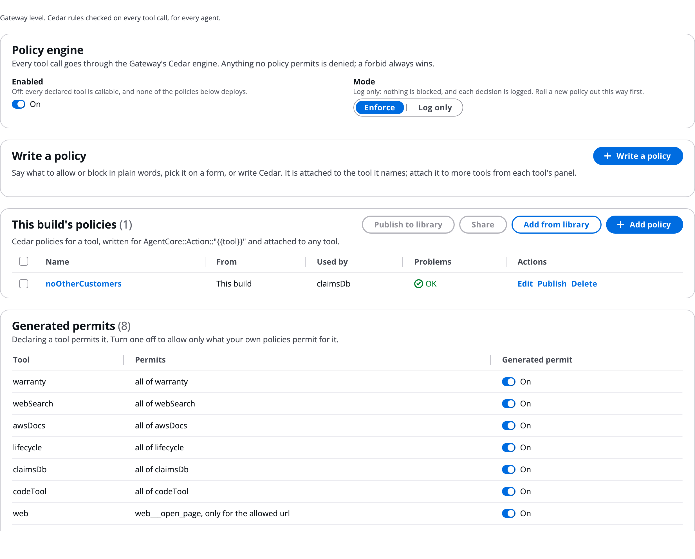

# Policies (Cedar)

Cedar policies decide every tool call at the build's AgentCore Gateway, for every agent. The engine denies by default: declaring a tool permits it, and anything no policy permits is refused, including a tool name an injected prompt invents. Your own rules narrow that further, and a `forbid` always wins over a `permit`. Use this to decide which tool calls are allowed: turn the engine on, write policies on the **Policies** tab, learn what the checker refuses, and read decisions in a run.

# Know where Cedar applies

Cedar is AgentCore Policy, attached to the Gateway. The Gateway evaluates it on each tool call, whichever agent makes it.

- There is no per-agent Cedar switch. A policy is attached to a **tool**, and governs that tool for every agent that calls it.
- On the canvas and on a run's graph, the policy shows as a **Policy** row on every agent that uses the tool it governs.
- `agents.<id>.agentcore.policy.enabled` has no effect, and a validation warning says so. It is kept only so older files still load.

The tab's first line says: _Gateway level. Cedar rules checked on every tool call, for every agent._

The Policies tab for the example build:



# Turn the engine on and pick a mode

Under **Policy engine**:

- **Enabled**: on by default. Off, every declared tool is callable and none of the policies deploys.
- **Mode**: **Enforce** blocks what the rules refuse. **Log only** blocks nothing and logs each decision. Roll a new policy out in Log only first.

In `workflow.json` this is `orchestrator.policy`, for the whole build:

```json
"orchestrator": { "policy": { "enabled": true, "mode": "LOG_ONLY" } }
```

# Write a policy

1. Click **Write a policy**.
1. Choose how to write it:
   - **Describe it**: type what to allow or block in plain words, for example _Never issue a refund over 500 dollars_, and click **Write it with AgentCore Policy**. AgentCore Policy writes the Cedar from your deployed build's tools. Click **Use this one** on the result you want. This needs the build deployed once with the engine on; until then the editor says **Deploy the build first**.
   - **Guided**: pick **Effect** (**Block** or **Allow**), the **Tool**, **Which of its tools**, and a **Condition** on an **Argument**: always, when given, one of, not one of, more than, or less than.
   - **Cedar**: type the statement yourself.
1. Give it a **Name** (letters and digits) and, optionally, **What it does**.
1. Read the check under the **Cedar** box. _Checks out._ means it is ready. The editor marks it **Allows**, **Blocks** or **Not valid** as you type.
1. Tick **Also save to my library** to keep it for other builds.
1. Click **Add to build**.

The policy is attached to the tool it names. Attach it to more tools from each tool's settings, or drag it onto a tool row on the canvas.

A Cedar statement. The resource always names the build's Gateway through a placeholder filled in at deploy:

```json
"policies": { "noBigRefunds": { "description": "No refund over 500",
  "statement": "forbid(principal, action == AgentCore::Action::\"refunds___issueRefund\", resource == AgentCore::Gateway::\"{{gateway}}\") when { context.input.amount > 500 };" } }
```

# Know what the checker refuses

The editor and the deploy refuse a policy that would not do what it seems to:

- a condition on anything but `context.input` (the call's arguments);
- a `context.input` condition on all of a tool's operations rather than one;
- a web search or knowledge-base tool named by anything but its real operation, `<key>___WebSearch` or `<key>___retrieve`;
- a `forbid` with no condition, which blocks every call and hides the tool from agents;
- an unconditioned permit for one tool, which AgentCore rejects.

# Manage generated permits and build-wide policies

- **This build's policies**: your named policies. The table works like every named-item tab; see [Skills](Skills.md).
- **Generated permits**: one row per tool, with what its permit allows. Turn a tool's **Generated permit** off to allow only what your own policies permit for it.
- **Build-wide policies**: policies written before policies were attached to tools. Each deploys as written. Its row on an agent card says "on &lt;tool> · every agent", and it cannot be taken off a card.

On a tool, `policy.tool` narrows the generated permit to one operation, `policy.restrictTo` sets argument allow lists (a knowledge base uses it to pin retrieval to its corpora), and `policy.permit: false` registers the tool without permitting it.

# See policy decisions in a run

- A refused call is a timeline line: "Refused by Cedar policy: &lt;tool>(&lt;arguments>)".
- In the Flow, each decision is a line such as "Cedar policy noOtherCustomers: DENY, call refused".
- On the run's graph, a **Policy** row shows its decisions, for example "2 decisions · 1 denied".
- A `model`-mode agent reads the refusal and can carry on with other calls. A `direct`-mode agent records it as one of its limitations.
- In Log only mode, decisions are in CloudWatch, and Analytics counts them as log-only. See [Analytics](Analytics.md).

# Ask the Assistant

The AgentExpress Assistant writes Cedar itself. It can turn the engine on or off, switch between **Enforce** and **Log only**, add named policies and attach them to tools, add build-wide policies, and narrow a tool's generated permit. It knows each tool's Cedar action names and can explain them. Requests you can paste:

- "Block any refund over 500 dollars on the refunds tool"
- "Switch the policy engine to Log only"
- "Allow only the getClaim operation of the claimsDb tool"
- "What is the Cedar action name for the webSearch tool?"

* **Describe it** with **Write it with AgentCore Policy**, and **Guided**, are the Policies tab's own writers. Use them there; the Assistant does not call them.
* With **Review changes** on **Auto**, policy changes are checked by a second model before they are saved.

More requests are on [Ask the Assistant](Ask_the_Assistant.md).

# Related pages

- [Tools tab and the Gateway](Tools_and_Gateway.md): the Gateway that evaluates every call
- [Interceptors](Interceptors.md): change, redact or log calls, not only allow or deny
- [Library](Library.md): one policy on many tools in many builds
- [One run in detail](Run_Traces.md): every decision of one run
