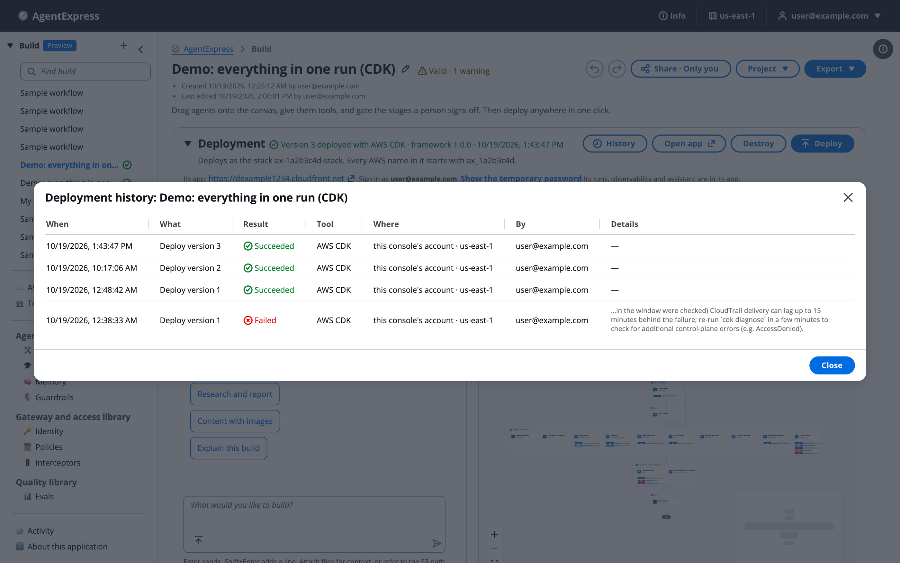

# Refine and redeploy

A build is never finished after its first deploy. You run it, watch what it does, score it, change it, and deploy the next version. If you own a build, you'll find what to change, change it in the right place, deploy the next version, and compare versions to see whether a change helped.

# The refine loop

The AgentExpress lifecycle, from design to evaluation, and the refine step that leads back to the build:

![The AgentExpress lifecycle: in the control plane 1 Design, 2 Build (Assistant or canvas), 3 Configure (tools, guardrails, memory, policies), 4 Test (test suites before you ship) and 5 Deploy (CDK or Terraform, your account); in the execution plane 6 Run (a prompt, a file or a trigger), 7 Review (people approve at gates), 8 Observe (cost, traces, analytics) and 9 Evaluate (evaluators score the answers); an arrow back from Evaluate to Build labelled 10 Refine: change a prompt or model with live config, or edit the build and deploy the next version; and the line Version history, test pass rates and evaluation scores show whether each change helped](images/design-lifecycle.png)

1. **Run** the workflow on real requests.
1. **Observe** what it did: the run page, the Observability page and Analytics.
1. **Evaluate** the answers with judges and test suites.
1. **Refine**: change a prompt or model with live config, or edit the build and deploy the next version.
1. **Compare** the new version with the old one, then go round again.

# Find what to change

| Signal | Where you see it |
|---|---|
| A run ended early or failed | The box at the top of the run page, and the **Timeline** tab's **Log** view |
| An agent's answer is wrong | The step panel's **Output** tab, and **Prompts & I/O** on the Observability page |
| A tool call was refused | "Refused by Cedar policy" on the **Timeline** Log, the **Cedar policy** filter on the **Flow** tab |
| A step is slow or costly | The **Timeline** chart's **Slowest** chips, and **Run detail** on the Observability page |
| An agent or tool fails often | The health score and **Why** on [Analytics](Analytics.md) |
| An agent has no guardrail or a tool no policy | **Configuration warnings** on Analytics |
| Quality dropped | Evaluation scores in the inspector, and the pass rate on the **Tests** tab |
| Reviewers keep revising the same step | Reviewer notes on the step panel's **Output** tab and in the Activity log |

# Change it in the right place

| To change | Use | Redeploy? |
|---|---|---|
| An agent's system prompt, model, temperature, top P, max tokens or stop sequences | [Live config](Live_Config.md) in the execution plane | No |
| The same, for good | The agent's settings in the control plane. See [Agents](Agents.md). | Yes |
| Stages, steps, gates or branches | The canvas. See [Stages and steps](Stages_and_Steps.md). | Yes |
| Tools, guardrails, memory, Cedar policies, identity | The build's tabs | Yes |
| Who may do what in the execution plane | The execution plane's sign-in groups. See [Users, groups and RBAC](Users_Groups_and_RBAC.md). | No |
| One run's bad step | **Re-run** with feedback. See [Resume, restart and re-run](Resume_Restart_Rerun.md). | No |

A change you can describe in a sentence can also be made by the AgentExpress Assistant, or by a coding agent on an exported bundle.

# Deploy the next version

1. Make the change in the control plane.
1. Click **Deploy**. The dialog offers the next version number.
1. Deploy with the same tool, to the same account and Region.

The deploy updates the same stack and keeps your login. It also picks up changes to library items the build uses, newer approved registry versions kept in sync, and secrets you changed. See [Deploy a build](Deploying_a_Build.md).

# Compare versions

Version numbers count successful deploys. Each run records the version it ran with, so you can tell old runs from new ones.

The deployment history of the example build, one row per deploy:

- **Runs table:** the **Workflow** column shows each run's version (v1, v2, ...). Old runs keep their own graph.
- **Tests tab:** **Pass rate by run** shows passed cases per build version. See [Test suites](Test_Suites.md).
- **Evaluation scores:** score the same kind of request on each version. See [Evaluations](Evaluations.md).
- **Cost and latency:** compare **Run detail** for a run on each version on the Observability page.
- **Live config:** the run page shows **Config: config vN**, so you can tell which prompt version a run used.

# Ask the Assistant

In the control plane, the AgentExpress Assistant can make any change to the build you can describe: a prompt, a model, a stage, a gate, a tool or a setting. It edits the same draft you see, checks the result, and fixes its own problems. Requests you can paste:

- "The letter agent's replies are too long: keep them under 150 words and drop the closing paragraph"
- "Reviewers keep revising the research step for missing sources: make the agent cite a source for every claim"
- "Switch the research agent to a cheaper model, and fall back to Claude Haiku 4.5 if it fails"
- "Update the intake agent based on &lt;the address of your new intake rules>"

Good to know:

- Attach reviewer notes, a sample of bad outputs or a new spec, and it reads them with your request.
- With **Review changes** on **Auto** or **Always**, a second model checks bigger changes, such as new agents or tool and security changes, before they're saved.
- To take back its last change, say "undo that".

What it can't do here:

- Deploy or redeploy. Choose **Deploy**, then compare the new version as above.
- Read runs, scores or test results. Tell it what you saw, or ask the Run Assistant in the execution plane.
- Change live config versions. Use the **Live config** page in the execution plane.

All requests by feature: [Ask the Assistant](Ask_the_Assistant.md).

# Related pages

- [The lifecycle](Lifecycle.md): the full lifecycle, step by step.
- [Live config](Live_Config.md): change prompts and models without a redeploy.
- [Test suites](Test_Suites.md): the pass rate by version.
- [Evaluations](Evaluations.md): scores from LLM judges.
- [Deploy a build](Deploying_a_Build.md): redeploy a change.
