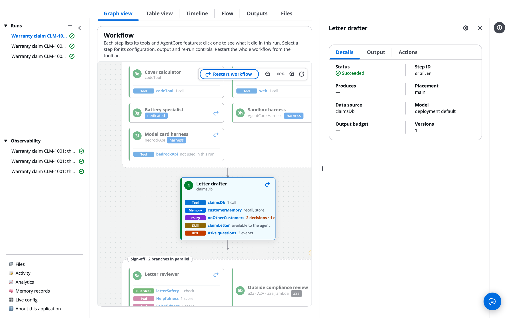

# Resume, restart and re-run

A run does not have to go right the first time. It can wait and resume after a person decides, restart from the first step, re-run one step and everything after it with a note, or re-run several agents of a parallel stage together. You can also stop it, or delete it. If you run workflows, you'll see each action, who may take it, and what a re-run keeps.

# Resume after a gate or a question

A run that reaches a review gate, an agent's question or a tool approval is saved in a checkpoint and waits. Nothing runs while it waits, and you can close the browser.

The run resumes by itself as soon as someone decides:

- **Approve** at a gate continues with the next step.
- **Revise** re-runs the step (or the agents marked Revise) with the note, then the gate pauses again.
- An **Answer** or **Decline** to a question lets the agent carry on from where it stopped. The model turns and tool calls made before the question are replayed from the checkpoint, not made or billed again.
- **Approve** or **Deny** on a tool call lets the agent carry on.
- A gate or question with a timeout is decided for you when the time runs out.

See [Human in the loop](Human_in_the_Loop.md) for the review boxes.

# Restart the whole workflow

Click **Restart workflow** on the graph's toolbar. The run starts again from the first step, with the same request and files.

**Restart workflow** appears once the run has settled and you hold the `rerun` permission.

# Re-run one step and everything after it

Re-run when a step's output is wrong and you want it redone with a note. The step and every step after it run again, and each review gate after it pauses again.

The step panel opens beside the graph when you click a step. Its **Actions** tab holds the re-run controls:

1. Click the step's card, or the re-run arrow at its top right.
1. In the step panel, open **Actions**.
1. In **Feedback**, write what the agent should change. The agent receives it as feedback.
1. Click **Re-run &lt;step name>**.

You can re-run once the run has settled: it succeeded, failed, was denied, was cancelled, or is waiting at a gate. You need the `rerun` permission; without it the panel says so.

# Re-run agents of a parallel stage

In a parallel stage with a review gate, the **Actions** tab also offers **Or re-run several of this stage together**.

1. Tick the agents to re-run. An agent that produced nothing cannot be ticked.
1. Write the **Feedback**.
1. Click **Re-run N selected together**.

They run again and are reviewed together at the stage's gate.

# What a re-run keeps

- Each version of a step's output is kept. The step panel's **Output** tab lists them with the reviewer note that caused each one.
- The Timeline draws a second bar labelled v2, and the Flow starts the step with "v2 after review: &lt;note>".
- A re-run uses the same live config version and the same model override as the run.
- A re-run counts against your daily spend limit, but is not counted as a new run.
- The Run Assistant can re-run agents for you, under the same permission.

# Cancel or delete a run

## Stop a run

Click **Stop run** at the top of the run page while it is running. The status turns to **Cancelling**, then **Cancelled**. You need the `cancel` permission.

## Delete a run

Click the trash icon beside the run in the Runs table or the left pane. Deleting permanently removes the run, its timeline and its share links. You need the `delete` permission.

# Ask the Assistant

Resuming, restarting, re-running, stopping and deleting runs all happen in the execution plane, so the AgentExpress Assistant can't do them. Use the buttons on the run page, or ask the [Run Assistant](Run_Assistant.md) to re-run agents.

In the control plane it can change the build settings behind these actions:

- "Only the leads group may re-run, stop or delete runs"
- "If nobody decides the evidence gate within 2 days, approve it"

Its changes apply once you choose **Deploy**. All requests by feature: [Ask the Assistant](Ask_the_Assistant.md).

# Related pages

- [Human in the loop](Human_in_the_Loop.md): gates, questions and tool approvals.
- [The run page and its tabs](Run_Page.md): the graph, the step panel and the Timeline.
- [Live config](Live_Config.md): change a prompt, then re-run.
- [Cost and spend limits](Cost_and_Limits.md): how re-runs count against limits.
