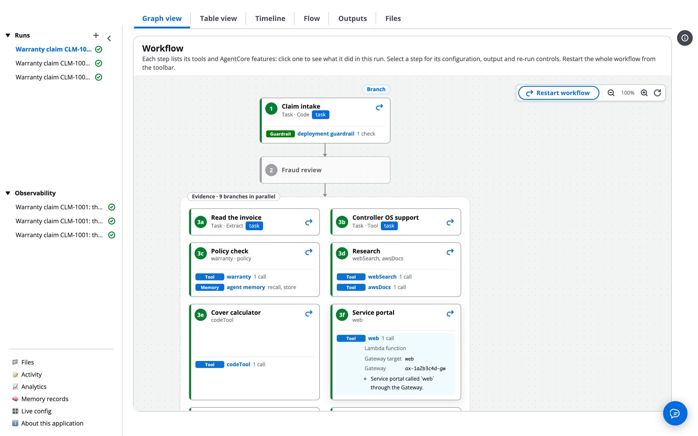
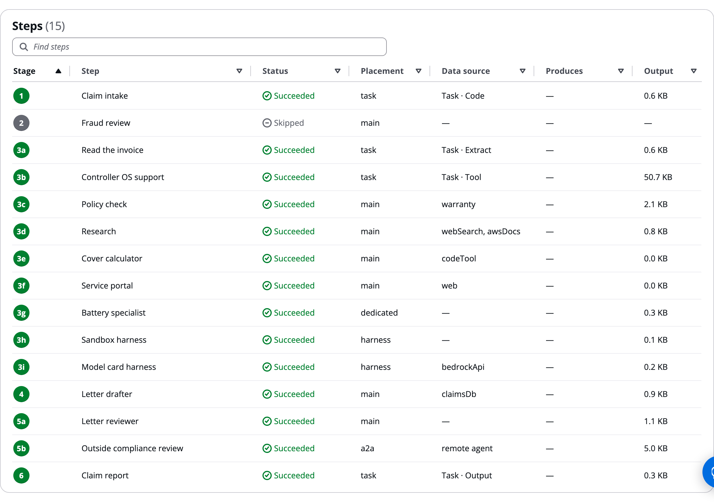
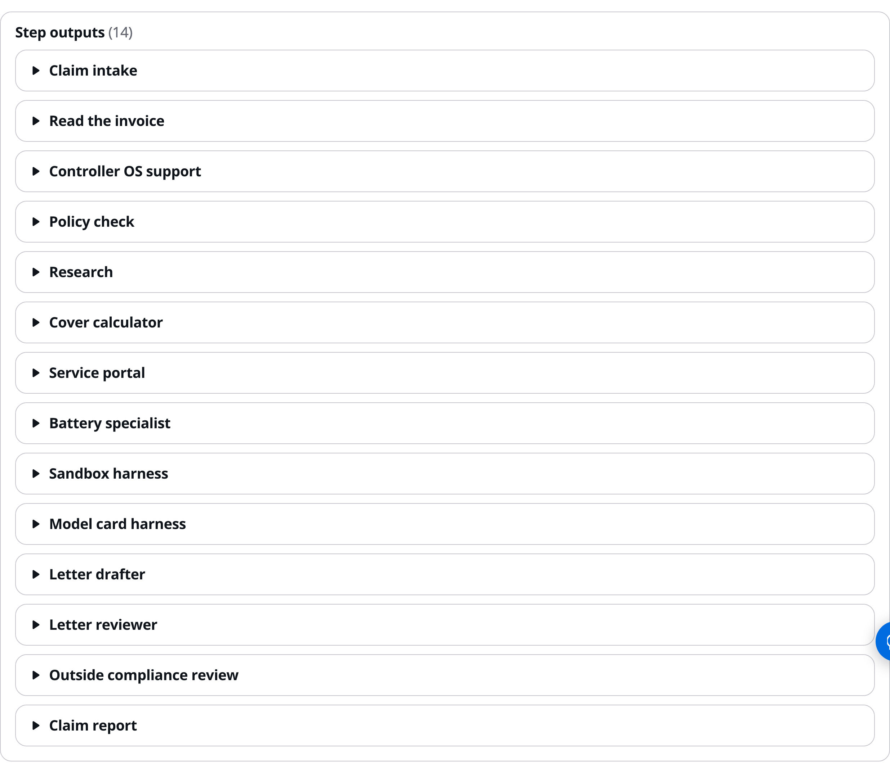
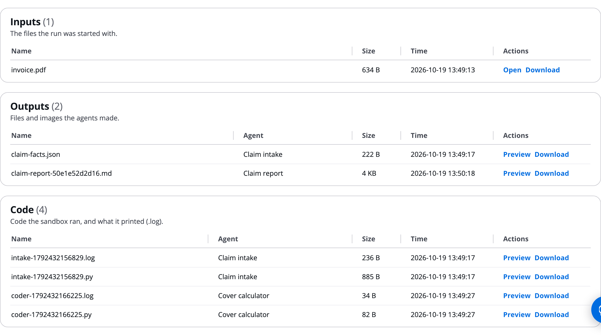

# The run page and its tabs

Opening a run shows the run page: its details at the top, then six tabs that show the same run in different ways: **Graph view**, **Table view**, **Timeline**, **Flow**, **Outputs** and **Files**. Anyone who runs a workflow uses it to follow a run as it goes, to find why a step did what it did, and to fetch what the run produced.

The run page refreshes every 2 seconds while the run is going, so you do not need to reload it.

# Read the run details

At the top is the request as the title, with the run ID under it. **Share** sits at the right, and **Stop run** appears while the run is still going.

The top of a run page: the title, the Request section, the Details box and the tabs:

| Field | Meaning |
|---|---|
| Status | The run's overall status |
| Progress | How many steps are complete. Skipped steps do not count. |
| Started, Duration | When the run started, and how long it has run so far or ran in total |
| Workflow | The deployed workflow version the run used |
| Config | Only when the run used a live config version, for example "config v3" |
| Model override | Only when someone picked models on Start run |
| Started by, Subject | Who started the run, and the subject given under Advanced |
| Files | The files the run started with, with their size, and "from S3" for files named by path |
| Awaiting | The gate or agent the run is waiting for, or a dash |

A run that ends early or fails says why in a box above the details, with an **Open the Timeline** button: a branch rule sent it to END, a reviewer or a gate's rule denied it, a guardrail blocked a step, or an agent failed. When the build sends runs to an observability tool, the header also shows whether this run reached it. See [Export to Langfuse, Datadog and others](Observability_Export.md).

If a step called a tool that acts as you and you have not connected your account yet, the step fails and the page shows **Connect**. Click it, sign in at the tool's provider, then click **Run the step again**. You connect once per tool.

# Graph view

The **Graph view** tab is open by default. It draws the workflow as deployed for this run: one card per step, top to bottom, in stage order.

The graph of the example build's run: numbered steps, a Branch pill, a skipped step and a parallel stage:

- **Number badge.** The stage's position, with a letter inside a parallel or sequence stage (3a, 3b). The colour is the status: green done, blue running, red failed, amber waiting, grey not started or skipped.
- **Chip.** Where the step runs when that is not the orchestrator: `task`, `dedicated`, `harness` or `a2a`.
- **Re-run arrow** at the top right of each card that has run. It opens the step panel on its **Actions** tab.
- **Component rows.** One row per tool, guardrail, memory, Cedar policy, skill, evaluation, identity and HITL setting the step has, each with what it did in this run, for example "1 call" or "2 decisions · 1 denied".
- **Pills.** A **Branch** pill sits above a step whose output picks what runs next; hover it for the rules. A **HITL gate** pill marks a step with a review gate.
- **Toolbar.** **Restart workflow** (see [Resume, restart and re-run](Resume_Restart_Rerun.md)) and the zoom buttons.

Click any component row to see what it did and what it is deployed as.

A tool row opened on the graph:

The names are worked out from the workflow, not read from AWS, so they say what the deploy creates. Some rows show "Deployed resource: not available".

## The step panel

Click a step card, or a row in the **Table view**, to open the step panel on the right.

The step panel for the Letter drafter step, open beside the graph:

- **Details:** status, step ID, what it produces, placement, data source, model, output budget (`maxTokens`) and how many times the step has run.
- **Output:** the step's output, rendered by its shape. When the step ran more than once, each version is listed, newest open, each with the **Reviewer note** that caused it.
- **Actions:** re-run controls. See [Resume, restart and re-run](Resume_Restart_Rerun.md).

# Table view

The **Table view** tab shows the same steps as a sortable table. Use it to find the largest step, or one that produced nothing.

The Table view of a finished run, sorted by stage:

**Find steps** filters the rows. Click a heading to sort; **Output** sorts by size. Click a row to open the step panel.

# Timeline

The **Timeline** tab has two views, **Chart** and **Log**, picked at the top right. It opens on **Chart**.

## Chart

A Gantt chart, with time running left to right.

The Timeline chart of the example build's run:

- **Top line** and **Totals:** the run's length, cost and number of calls. **Slowest** chips jump to the three slowest calls.
- **Rows:** one per step, grouped by stage. A re-run adds a second bar labelled v2.
- **Inside each bar:** its model, tool, guardrail, memory, Cedar policy and evaluation calls. Hover or focus a call for its details.
- **Critical path:** bars outlined in black set the run's length. **HITL wait:** a hatched band marks each wait at a gate.
- **Zoom:** **Zoom out**, **Fit to width**, **Zoom in**.

## Log

**Log** shows the run's timeline lines as a table: **Time**, **Step** and **Message**, newest first.

The Log view of the same run:

**Find events** filters the lines. Look here for branch decisions, guardrail blocks and masks, model routing and fallbacks, Cedar and interceptor refusals, questions to a person and their answers, reviewer notes, files saved, and warnings about figures that appear in no earlier output.

# Flow

The **Flow** tab tells what each agent did with the Gateway, memory, Cedar policy and guardrails, one line per event. There is nothing to turn on. It has two views, **Story** and **Summary**, and a replay bar: back, play and forward, **1x** or **2x**, and a slider.

The Story view of the example build's run:

- **Story** tells the run top to bottom: one header per stage, then each agent and one line per event, with its time and cost. Filter with the chips. Click a line for its full sentence, latency and cost.
- **Summary** shows one card per agent with its status and number of events, and an **AgentCore** column that counts the run's events by kind.

The Summary view of the same run:

Prompts, answers and tool results are not in the Flow; they are on the Observability page. Branch decisions are on the Timeline. A shared link has no Flow tab.

# Outputs

The **Outputs** tab lists each step that produced output, as a section you can expand.

The Outputs tab of the example build's run, with every section collapsed:

A skipped step has no section. For earlier versions of a step's output, open the step panel's **Output** tab.

# Files

The **Files** tab lists the run's files in three groups: **Inputs** (the files the run started with), **Outputs** (files and images the agents made) and **Code** (code the Code Interpreter sandbox ran, and a .log of what it printed).

The Files tab of the example build's run:

**Download** saves a file, **Preview** shows text, Markdown, JSON and CSV in the page, and **Open** opens an image or PDF in a new tab. For all your runs' files in one list, see [Files](Files_Page.md).

# Ask the Assistant

The run page is in the execution plane, so the AgentExpress Assistant has nothing to set on it. It can't open a run, re-run a step, or connect your account to a tool. To ask about one run, such as why it ended, what a step wrote or what it cost, use the [Run Assistant](Run_Assistant.md) in the execution plane.

It can change the build, and the change shows on the run page of runs after the next deploy:

- "Keep the files agents save, for 30 days" (the **Files** tab)
- "After triage, send cases whose disposition is escalate to the investigator, and the rest to the adjuster" (the **Branch** pill)
- "Explain what each stage of this build does, and which tools each agent calls"

All requests by feature: [Ask the Assistant](Ask_the_Assistant.md).

# Related pages

- [Start a run: prompt, file or trigger](Starting_a_Run.md): how the run started.
- [Human in the loop](Human_in_the_Loop.md): the boxes that appear when a run waits.
- [Resume, restart and re-run](Resume_Restart_Rerun.md): the step panel's Actions tab.
- [One run in detail](Run_Traces.md): prompts, tokens and cost for this run.
- [Files](Files_Page.md): every file of your runs.
