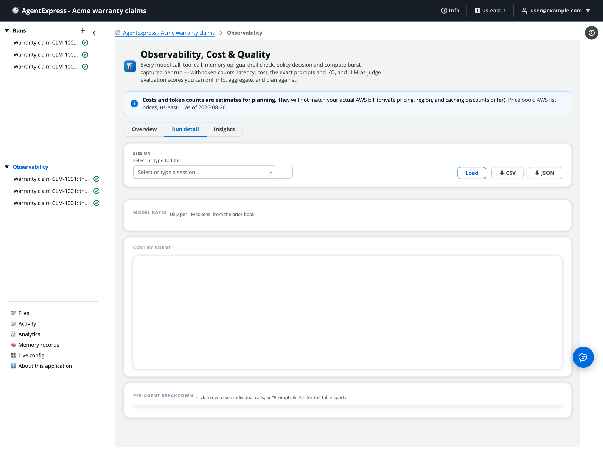

# One run in detail

The **Run detail** tab of the Observability page shows one run down to each call: its cost, tokens and latency, split by agent, and the exact prompt, input and output of each agent. Use it to answer "why did the agent say that?" and "where did the money go?". You'll load a run, read its figures, list an agent's calls, and open the **Prompts & I/O** inspector.

# Load a run

1. Open **Observability** in the left pane and click the **Run detail** tab, or click a run under **Observability** in the left pane.
1. In **Session**, select a run or type to filter, and click **Load**.

The Run detail tab before a run is picked:

**CSV** and **JSON** download every call of the loaded run.

# Read the totals and rates

Once a run is loaded, the top of the tab shows:

- **Run date**, with the start and end times.
- **Run cost**: the estimated cost of every call in the run.
- **Tokens**: total, with input and output.
- **Calls**: every metered call.
- **Model+tool latency**: the sum of every call's time, not the time on the clock. Calls in parallel stages add up, so this can be longer than the run.

**Model rates** lists the input and output price per million tokens for each model the run used, from the price book. When the run used prompt caching, a **Cache saving** card joins the totals. **Cost by agent** is a bar chart, most expensive first.

A run's figures here are the same ones the spend limits count. See [Cost and spend limits](Cost_and_Limits.md).

# Break the cost down by agent

**Per-agent breakdown** has one row per agent:

| Column | What it shows |
|---|---|
| Agent | The agent's name and id, and a **Prompts & I/O** button |
| Model(s) | The models it called |
| Input, Output | Its input and output tokens |
| Cache read, Cache write | Input tokens read from or written to the prompt cache. They are part of Input. |
| Cache saving | The cached tokens at the normal input rate, minus what they cost at the cache rates. _unknown_ when a cache token had no published rate, and a dash when nothing was cached. |
| Tools | How many tool calls it made |
| Latency | The sum of its calls' times |
| Cost | Its estimated cost |

Click a row to list that agent's individual calls: each model, tool, memory, guardrail and policy call with its own figures. A model call's rate marked `~` is an estimate, because no rate was found for that model. A separate row, **AgentCore Runtime · compute**, carries the runtime's compute cost.

Steps with no model, such as task steps, show tool calls and no tokens.

# Open Prompts and I/O

Each agent row has a **Prompts & I/O** button. It opens the inspector for that agent:

- its **system prompt**;
- its **input**;
- its **output**;
- the AgentCore features it used;
- its evaluation scores.

When the agent ran more than once (a revise or a re-run), pick the version at the top. Each version is shown as it ran. Copy any block with its copy button.

Each model call in the inspector shows its tokens, latency and cost. When the call used prompt caching, it also shows **Cache read**, **Cache write**, **Cache cost**, **Cache saving** and **Cache points**, and a _cache hit_ or _cache miss_ badge. A miss that read and wrote nothing may mean the cached part is below the model's minimum.

Good to know:

- An A2A agent makes its own model call, so its inspector has no local prompt.
- Captured text is cut at `OBS_MAX_CAPTURE_CHARS`.
- Shared run links never show prompts.

# Score an agent from the inspector

The inspector's **Evaluation** part lists each evaluator's score with its label and the judge's explanation.

- If the agent has evaluations turned on and was not scored yet, click **Evaluate** to score it now.
- Click **Re-evaluate** to score it again.
- You need the `evaluate` permission. Each evaluator is a billed model call.

See [Evaluations](Evaluations.md).

# Where to look first

When a run goes wrong:

1. The box at the top of the run page that says why the run stopped or ended.
1. The run's **Timeline** tab, **Log** view, filtered with **Find events**.
1. The run's **Flow** tab with **Problems only**.
1. **Run detail**, then **Prompts & I/O**, to see exactly what the agent was given and returned.

# Ask the Assistant

**Run detail** only reads a run, so the AgentExpress Assistant has nothing to set here. It can't load a run, read its prompts or press **Evaluate**. Ask the [Run Assistant](Run_Assistant.md) in the execution plane about one run's cost, latency, outputs or scores.

Once you know what to change, the AgentExpress Assistant can change the build for the next deploy:

- "Turn on evaluations with Faithfulness for the letter agent, scored on demand"
- "The research agent's answers are too long: limit it to 2,000 output tokens"

All requests by feature: [Ask the Assistant](Ask_the_Assistant.md).

# Related pages

- [Observability](Observability.md): the page and its other tabs.
- [The run page and its tabs](Run_Page.md): the same run as a graph, timeline and story.
- [Evaluations](Evaluations.md): the judges behind the scores.
- [Cost and spend limits](Cost_and_Limits.md): where each price comes from.
