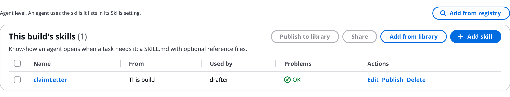

# Skills

A skill is know-how an agent opens only when a task needs it: a description of when to use it, instructions (the SKILL.md body), and optional reference files. Use skills for a house style, a checklist or a procedure that would make a system prompt too long. Here you add skills on the **Skills** tab, give them to agents, and learn the table layout every named-item tab shares.

# Read the Skills tab

The tab's first line says: _Agent level. An agent uses the skills it lists in its Skills setting._

The Skills tab with one skill:



A skill is text. Nothing in it runs. Each skill holds up to 20 reference files (Markdown, text, JSON, CSV or YAML), 200 KB of text in all.

# Add a skill

1. Click **Add skill**.
1. Give it a name, **When to use it** (what the agent reads to decide whether to open it), and its **Instructions**. Or load a **SKILL.md file**.
1. Add **Reference files** with **Add a file** or **Upload files**.
1. Save it.
1. Open an agent and pick the skill in its **Skills** setting, or drag the skill from the palette onto the agent.

In `workflow.json`:

```json
"skills": {
  "refundPolicy": {
    "description": "When a customer asks for money back.",
    "instructions": "1. Check the purchase date in the order.\n2. Within 30 days with a receipt: refund. Otherwise offer store credit.",
    "files": { "policy.md": "Refunds need a receipt and are paid to the original card." }
  }
}
```

# How an agent uses a skill

- **An agent with tools in `model` tool mode** sees each skill's name and description, and opens what it needs, files included, with a `use_skill` tool. Opening a skill does not count against its tool calls, and is never treated as evidence.
- **Any other agent** gets its skills added to its instructions in full, up to 60,000 characters.

In a run, the **Skill** row on the graph says "available to the agent", and the timeline says "Opened skill: &lt;name>" when the agent opens it.

A harness agent takes skills from the AWS skills catalog, a Git repository or an S3 prefix instead. See [Runtimes](Runtimes.md).

# Get skills from the library or registry

- **Add from library** uses a skill from your library live in this build. See [Library](Library.md).
- **Add from registry** takes an approved skill from your organisation's AWS Agent Registry.
- Admins also see **Publish to registry**, to submit the build's skills for approval. See [AWS Agent Registry](Agent_Registry.md).

# Use the named-item tables

The Skills, Memory, Guardrails, Policies and Evals tabs, and the saved logins on the Identity tab, share one table layout:

| Button or column | What it does |
|---|---|
| **Add** (skill, memory, guardrail, policy, evaluator) | Creates a new item in this build |
| **Add from library** | Uses an item from your library live in this build |
| **Publish to library (n)** | Copies the ticked items to your library, where other builds can use them |
| **Share (n)** | Publishes the ticked items first, then opens the share dialog |
| **From** | _This build_, _Library · yours_, _Library_ with the owner's email, or _Missing from the library_ |
| **Used by** | The agents (or tools) that use the item |
| **Problems** | **OK**, the problem itself, or how many there are |
| **Edit**, **Publish**, **Delete** | On each row |
| **Make a copy for this build** | On a library item: gives this build its own copy, so later library edits do not reach it |
| **Unpublish** | Takes the item out of the library. Every build that used it keeps its own copy. |

Names are letters and digits, starting with a letter, up to 32 characters.

# Ask the Assistant

The AgentExpress Assistant can write a skill, with its description, instructions and reference files, give skills to agents, take an approved skill from your AWS Agent Registry, and set a harness agent's skills. Attach your SKILL.md or reference files and it works from them. Requests you can paste:

- "Add a skill refundPolicy from the attached refund-policy.md and give it to the drafter"
- "Find a brand voice skill in our registry and give it to the writer"
- "Give the letter writer the claimLetter skill"

**Publish to library**, **Share** and **Publish to registry** are buttons on the Skills tab; the Assistant does not publish. More requests are on [Ask the Assistant](Ask_the_Assistant.md).

# Related pages

- [Agents](Agents.md): the agent's Skills setting
- [Memory](Memory.md): the next configuration tab
- [Library](Library.md): share a skill across builds
- [AWS Agent Registry](Agent_Registry.md): approved skills from your organisation
