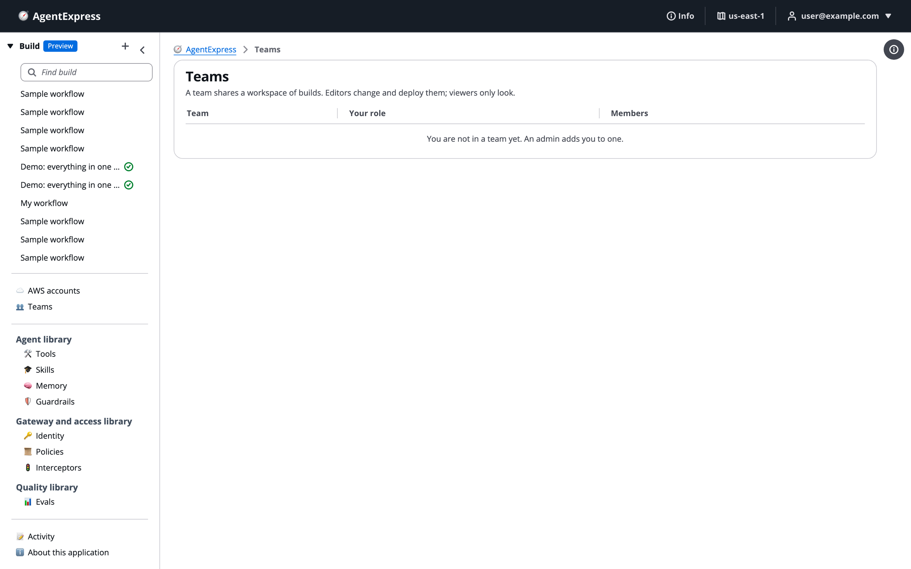

# Teams and workspaces

A team is a group of people who share a workspace of builds in the control plane, each as owner, editor or viewer. Use a team when the same people work on many builds together, so you do not have to share each build one by one. You'll create a team, give its members roles, switch workspaces, move builds in, and see how teams differ from sign-in groups.

Teams need nothing turned on: no setting, resource or IAM permission. They apply to builds in the control plane only. A deployed build's own execution plane and its users are not changed by a team.

# Open the Teams page

Click **Teams** in the left pane of the control plane. The table lists your teams, your role in each, and how many members each has. An admin sees every team.

The Teams page for someone who is not in a team yet:

# Create a team

Only an admin creates teams.

1. On the **Teams** page, click **New team**.
1. Type the team's **Name**.
1. Under **People**, click **Add person**, type an email address, and pick a role. Add at least one owner.
1. Under **Sign-in groups**, click **Add group** to give everyone in a group of your sign-in provider a role.
1. Click **Save**.

To change a team, click its name. To delete one, click the delete icon on its row. A team that still has builds cannot be deleted: move or delete its builds first.

## Manage members

A team's owners add and remove its editors and viewers:

1. Click the team's name on the **Teams** page.
1. Add, change or remove people and groups.
1. Click **Save**.

Only an admin adds, removes or changes an owner. Someone who is not an owner sees the team's members read-only.

# Team roles

| Role | Label in the control plane | Can do |
|---|---|---|
| Owner | _Owner, manages members_ | Everything an editor can, plus add and remove editors and viewers |
| Editor | _Editor, changes and deploys_ | Open, change, deploy and destroy the team's builds; create builds in the team; move builds into it |
| Viewer | _Viewer, looks only_ | Open a team build and see its deployments, documents and secret names. Cannot save, deploy, destroy, share, move or delete. |

- A member is an email address or a group of your sign-in provider. Someone named more than once gets the highest of their roles.
- Deploying and destroying still need the `deploy` and `destroy` permissions from the person's sign-in groups.
- A viewer who opens a team build sees _You can look at this build, not change it_. Their changes are not saved.
- Anyone not in the team gets "not found" for its builds.
- An admin can read every build, but edits a team's builds only as a member.

# Switch workspaces

Once you are in a team, a switcher appears above the build list in the left pane. It offers **My builds** and each of your teams, with your role.

- Pick a team to see its builds.
- A build you create while a team is picked is created in that team. Editors and owners can do this.
- Pick **My builds** to go back to your own builds.

# Move a build into a team

1. Open the build.
1. Open **Project** and choose **Move to team…**.
1. Pick a team where you are an editor or owner, and click **Move**.

Everyone in the team can then see the build, and its editors can change and deploy it. It keeps its deployment, versions and sharing. You can also move a build between two teams where you are an editor or owner. Only the person who created a build can move it back to their own builds.

## Good to know

- **The creator keeps access.** A build's creator never changes. A team build still deploys into its creator's connected AWS accounts or this control plane's own, keeps the creator's Terraform state, and keeps the logins of its execution plane.
- **Sharing still works.** You can share a team build with someone outside the team. See [Share a build](Sharing_a_Build.md).
- **It is logged.** Creating, changing and deleting teams, and moving builds, appear in the Activity log of whoever made the change.

# Teams versus groups

AgentExpress has three ways of grouping people. They answer different questions.

|  | Sign-in groups | Teams | Sharing groups |
|---|---|---|---|
| Decides | Which **actions** a person may take: start, approve, deploy, see everyone's activity, be an admin | Who **shares which builds**, as owner, editor or viewer | Who a build or library item is **shared with** |
| Lives in | Your sign-in provider | The control plane | The control plane |
| Managed by | Whoever administers the sign-in provider | Admins create teams and name owners; owners add editors and viewers | Admins, on the Admin page's **Groups** tab |
| Applies to | The control plane and each execution plane (each execution plane has its own groups) | Builds in the control plane only | Builds and library items in the control plane |

How they combine:

- Being an **editor** lets you change a team's builds. To **deploy** one, you still need a sign-in group that holds `deploy`.
- A team member can be a whole sign-in group, so everyone in that group gets the same team role.
- Making someone an **admin** is a sign-in group change, never a team or sharing change. See [Users, groups and RBAC](Users_Groups_and_RBAC.md).

# Ask the Assistant

The AgentExpress Assistant can't manage teams or move builds. Use these instead:

- Create a team, or change its members and roles: the **Teams** page.
- Move a build into a team: **Project → Move to team…** on the build.
- Switch workspaces: the switcher above the build list in the left pane.

In a team build, an editor or owner can still ask the Assistant to change the build itself. See [Ask the Assistant](Ask_the_Assistant.md).

# Related pages

- [Share a build](Sharing_a_Build.md): share one build with people or a sharing group.
- [Users, groups and RBAC](Users_Groups_and_RBAC.md): the actions each sign-in group may take.
- [Sign-in and security](Security.md): what stays private to each person.
- [Deploy a build](Deploying_a_Build.md): what editors can deploy.
