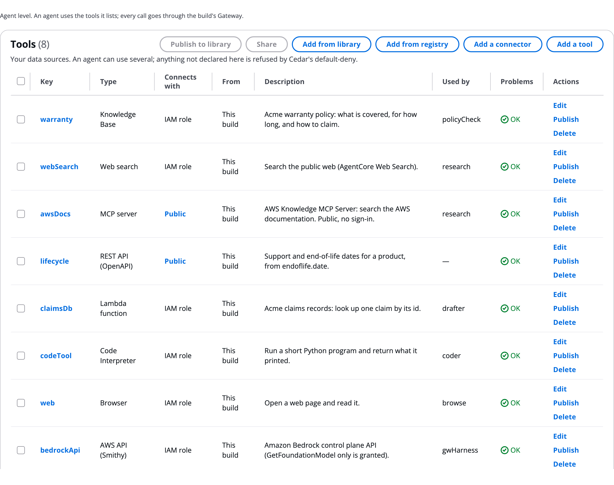

# Tools tab and the Gateway

The **Tools** tab of **Build manually** lists every tool in the build. Behind it is the AgentCore Gateway: one MCP endpoint in front of all the build's tools, which every tool call goes through. Use this to review the build's tools, write a code tool, and see what the Gateway does on each call. To add a tool, see [Add tools and connectors](Adding_Tools.md).

# Read the Tools tab

Each tab of **Build manually** starts with one line saying the level it works at. For **Tools**: _Agent level. An agent uses the tools it lists; every call goes through the build's Gateway._ The tab's label shows how many tools the build has, for example **Tools (8)**.

The Tools tab for the example build:

| Column | What it shows |
|---|---|
| **Key** | The tool's key. Click it to open the tool's settings on the Design tab. |
| **Type** | Knowledge Base, Web search, MCP server, REST API (OpenAPI), Lambda function, REST API (API Gateway), AWS API (Smithy), Code Interpreter or Browser |
| **Connects with** | How the Gateway signs in to it: **Public**, **IAM role**, **API key**, **App login**, **User login** or **On behalf of user** |
| **From** | _This build_, _Library_ with the owner, or _Missing from the library_ |
| **Description** | What the tool does. Agents read it to decide when to call the tool. |
| **Used by** | The agents that list it |
| **Problems** | **OK**, or the number of errors |
| **Actions** | **Edit**, **Publish**, **Make a copy for this build**, **Unpublish** and **Delete**, as they apply |

Buttons at the top:

- **Add a tool** and **Add a connector**: see [Add tools and connectors](Adding_Tools.md).
- **Add from library**: use a tool from your library, live. See [Library](Library.md).
- **Add from registry**: take an approved MCP server from your AWS Agent Registry. See [AWS Agent Registry](Agent_Registry.md).
- **Publish to library (n)** and **Share (n)**: keep the ticked tools for other builds, or publish and share them in one go.

# Write a code tool

A Lambda tool can hold code written in the build. Its settings then show the code and these sections:

- **Where the code comes from**: **Written here**, **Upload**, **Git repository** or **Amazon S3**. Git and S3 code is fetched at each deploy. See [Tool types in depth](Tool_Types.md#choose-where-code-comes-from).

* **What it may reach**: **A secret it may read**, **A DynamoDB table** (**Read** or **Read and write**), **An S3 prefix**, **A private network (VPC)**, its timeout and memory. With none, the code has no AWS access.
* **Check and run**: **Check and run in the sandbox** runs a syntax check, lint and a security scan, then the test events in an AgentCore Code Interpreter sandbox.
* **Test the deployed tool**: after a deploy, **Test tool** calls the deployed function with an event and shows its log.

A grant reaches only a secret, table or bucket tagged `agentexpress:code-tools=true`. The deploy is refused unless the code parses and defines the handler, requirements are pinned as `name==version`, and no key is hard-coded. More on [Tool types in depth](Tool_Types.md).

# What the Gateway does

Agents never call a tool directly. On every tool call, from every agent:

1. The agent calls the Gateway with a machine token.
1. The Gateway checks the call against the build's Cedar policies. See [Policies (Cedar)](Policies_and_Cedar.md).
1. It runs any interceptors. See [Interceptors](Interceptors.md).
1. It signs in to the tool with the tool's credentials and calls it.
1. It returns the result to the agent.

Because every call goes through the Gateway, a prompt cannot reach a tool that was not declared, and a tool name an injected prompt invents is denied. Secrets for tools are kept in AgentCore Identity and sent by the Gateway; agents never see them.

# What the deploy creates

- A Gateway for the build, created when the workflow has tools. Each tool becomes a target on it.
- A JWT authorizer pinned to the agents' machine client, so only this build's agents can call it.
- A Cedar policy engine attached to it, unless policy is turned off.
- With tools that act as the person, a second Gateway that trusts the people's sign-in instead.
- For each hosted MCP server, its own AgentCore Runtime, added as a target that the Gateway calls with SigV4. See [Tool types in depth](Tool_Types.md#host-an-mcp-server-here).

The Gateway publishes each tool operation as `<key>___<operation>`. Use letters and digits starting with a letter for a tool key, such as `policyDocs`, because the key becomes the Gateway target name and part of the Cedar policy name.

Without the Gateway, every agent bound to a tool fails with `ToolUnavailable`, and the run says why. The framework never makes up data.

# Give each agent its own Gateway identity

By default the agents share one machine client to sign in to the Gateway. Set **Gateway identity** to `perAgent` on the [Settings tab](Settings.md) (`orchestrator.gatewayIdentity`) to give each tool-using agent its own client, so the Gateway, its Cedar policy and its interceptors know which agent called. It needs the Cognito pool the deployment creates.

# See the Gateway in a run

- On the canvas, the AgentCore rail lists the **Gateway**. See [Build manually on the canvas](Canvas.md).
- On a run's graph, opening a tool row shows its Gateway target and the Gateway's name.
- Each tool call is a line on the run's timeline, with its policy decision. See [The run page and its tabs](Run_Page.md).

# Ask the Assistant

The AgentExpress Assistant can change or remove any tool, write a code tool's `handler.py`, `requirements.txt` and test events, set what the code may reach, point a tool at code in Git or S3, and switch the Gateway identity to one per agent. It can also explain the Tools tab and what the deploy creates. Requests you can paste:

- "Write a Lambda tool orderLookup that reads an order by id from the orders DynamoDB table, read only"
- "Use the attached handler.py as the code of the claimsDb tool"
- "Take the code of the pricing tool from branch main of &lt;the repository's address>, folder tools/pricing"
- "Give each agent its own Gateway identity"

Do these on the Tools tab or in the tool's settings instead:

- **Check and run in the sandbox** and **Test tool**: the Assistant does not run code.
- **Publish**, **Unpublish** and **Make a copy for this build**: row actions on the Tools tab. Ask the Assistant for a copy and it writes the tool into this build.
- A secret's value, and a Git token's value: it names them in the **Secrets** card, and you type them there.

With **Review changes** on **Auto**, code changes and new grants are checked by a second model before they are saved. More requests are on [Ask the Assistant](Ask_the_Assistant.md).

# Related pages

- [Add tools and connectors](Adding_Tools.md): add a tool and give it to an agent
- [Tool types in depth](Tool_Types.md): each tool type's settings
- [Policies (Cedar)](Policies_and_Cedar.md): the rules the Gateway applies
- [Interceptors](Interceptors.md): functions on every tool call
- [Identity](Identity.md): credentials the Gateway sends
