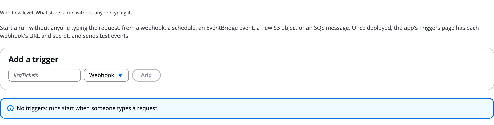

# Triggers

A trigger starts a run without anyone typing the request: a webhook, a schedule, an EventBridge event, a new S3 object or an SQS message. Use one when runs should start from another system, such as a new Jira issue or a nightly report. Here you add triggers on the **Triggers** tab, and an admin sets webhook secrets and sends tests on the execution plane's **Triggers** page.

# Read the Triggers tab

The tab's first line says: _Workflow level. What starts a run without anyone typing it._

The Triggers tab with no triggers yet:



# Add a trigger

1. Under **Add a trigger**, type a name and pick a type.
1. Click **Add**.
1. Fill in its fields.

| Type | Starts a run when | Fields of its own |
|---|---|---|
| **Webhook** | GitHub, Jira, ServiceNow, Slack, Stripe or your own system posts to its URL | **Signature**: `agentexpress`, `github`, `slack`, `stripe` or `token` |
| **Schedule** | An EventBridge Scheduler expression fires | **Expression** (`cron(...)` or `rate(...)`) and **Time zone** |
| **EventBridge event** | An event matches a pattern | **Event pattern** and **Event bus** |
| **S3 object** | An object is created in a bucket | **Bucket** and **Prefix**. The bucket must send its events to EventBridge. |
| **SQS message** | A message arrives on a queue | **Queue ARN**, or none for a queue made for you with a dead-letter queue |

# Write the request it sends

Every trigger has a **Request**: the run's request, filled from the delivery with placeholders such as `body.x`, `headers.x`, `detail.x`, `event.x` and `time`, each written inside double curly braces. The delivery is untrusted text and never runs as code.

```json
"triggers": {
  "jira": { "type": "webhook", "prompt": "Triage {{body.issue.key}}: {{body.issue.fields.summary}}",
            "attachPayload": true, "maxRunsPerHour": 30 },
  "nightly": { "type": "schedule", "expression": "cron(0 6 * * ? *)", "prompt": "Daily summary",
               "runAs": "service", "approvers": ["reviewers"], "gates": "auto" }
}
```

# Set who it runs as

Every trigger also has:

- **Runs as**: **The build's owner** (the default) or **The trigger (service)**, whose runs its **Approvers** groups read and decide.
- **HITL gates**: whether its runs' gates wait for a person or approve themselves.
- **Most runs an hour** (default 60), **Bring the delivery** (attach the payload to the run) and **Same delivery key** (a delivery seen in the last day starts no second run).

Spend and run limits apply to trigger runs, as whoever the trigger runs as. On the Runs table, **Started by** shows the trigger's name and type.

# Manage triggers in the execution plane

After a deploy, admins see **Triggers** in the execution plane's left pane. Each trigger shows its type, who it runs as, and its request.

For a webhook:

1. Copy its **URL**. Deliveries are JSON posts of at most 256 KB.
1. Under **Secret**, click **Generate** (or **Rotate**). For GitHub, Slack and Stripe signatures, paste the vendor's signing secret and click **Save** instead.
1. Copy the secret when the page shows it: it is not shown again. For `agentexpress` and `token` signatures the page also shows a signed `curl` command.
1. Until a secret is set, every delivery is refused.

For every trigger, **Send a test delivery** lets you edit a test body and **Send** it. **Last deliveries** lists recent deliveries with their outcome and the run each started.

> [!NOTE]
> A webhook route is the only route with no sign-in token. It is proven by an HMAC signature of the body, with a freshness window, a per-delivery key and an hourly cap.

# Ask the Assistant

The AgentExpress Assistant can add, change or remove triggers of every type, with their request, who they run as, approvers, gates and limits. It rewrites the whole list of triggers each time, so the others are kept. Requests you can paste:

- "Add a webhook trigger for new Jira issues that triages the issue key and summary, at most 30 runs an hour"
- "Run a daily summary at 6:00 UTC as the service, with its gates approved automatically"
- "Start a run when a file lands under incoming/ in the bucket &lt;your bucket>"

* Webhook addresses, secrets and test deliveries are on the execution plane's **Triggers** page, for admins, after a deploy.
* With **Review changes** on **Auto**, trigger changes are checked by a second model before they are saved.

More requests are on [Ask the Assistant](Ask_the_Assistant.md).

# Related pages

- [Start a run: prompt, file or trigger](Starting_a_Run.md): the three ways a run starts
- [Human in the loop](Human_in_the_Loop.md): gates on unattended runs
- [Cost and spend limits](Cost_and_Limits.md): limits that apply to trigger runs
- [Settings tab](Settings.md): the next configuration tab
