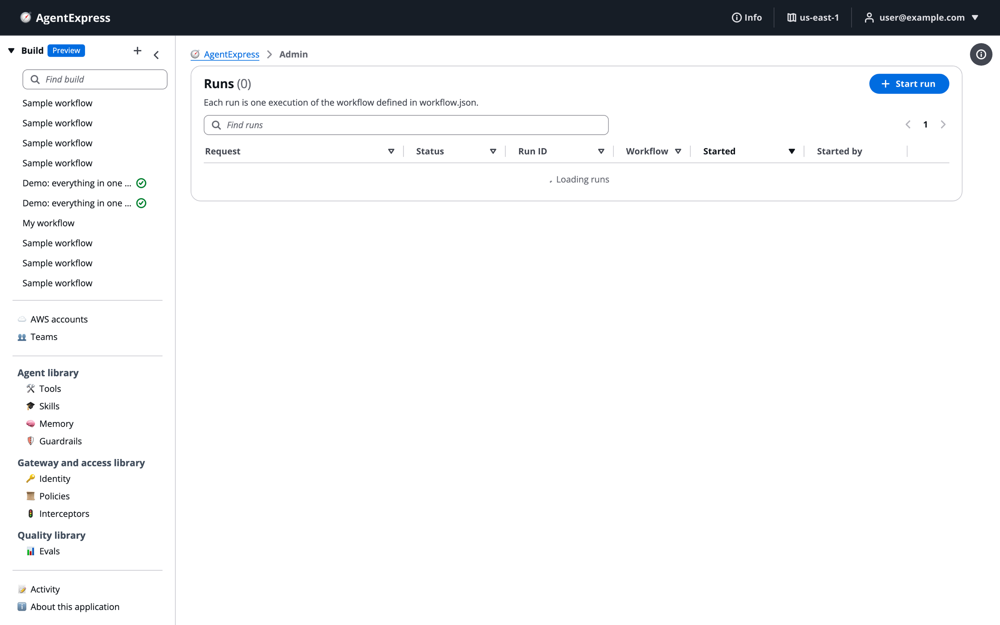

# Users, groups and RBAC

Sign-in groups decide what each person may do in the control plane and in every execution plane. Read this when a button is greyed out, when you add people to a deployment, or when you need an admin. You'll map actions to groups in `authorization.actions`, create users and make someone an admin.

# How groups grant actions

Each person signs in with an identity provider, and their sign-in token carries their **groups**. A build's `authorization` block maps each **action** to the groups allowed to take it. The server checks every action. The control plane and the execution plane also hide or greys out what you may not do. The Run Assistant is held to the same rules, so asking it to approve a gate is not a way around them.

The rules:

- An action **not listed** is unrestricted: anyone signed in may take it.
- An action listed **with groups** needs at least one of them.
- An action listed with an **empty list** is denied to everyone. That is how you switch a capability off.
- `audit`, `admin` and `override` are closed unless a group is named. `insights` is also closed whenever anything else is restricted.
- A denied action returns an error that names the group required. A person in no group sees **Approve**, **Revise** and **Deny** greyed out.

Your groups travel in your sign-in token. After a group change, sign out and sign in again. The user menu in the top bar shows your current groups.

## Where the groups come from

**Groups claim** (`authorization.groupsClaim`) tells the execution plane which token claim holds the groups:

- `cognito:groups` for Amazon Cognito (the default);
- `groups` for Okta;
- `roles` for Microsoft Entra ID (application roles assigned to the person);
- your namespaced claim for Auth0, added by a post-login Action.

With Auth0, Okta or Entra ID, a wrong claim means every restricted action is denied.

# The actions

| Action | Allows | Groups in the shipped sample |
|---|---|---|
| `start` | Start a run | Unrestricted |
| `decision` | Approve, revise or deny a gate; answer an agent's question or a tool approval | `approvers`, `members` |
| `rerun` | Re-run an agent and everything after it | `approvers`, `members` |
| `cancel` | Stop a running workflow | `approvers`, `operators`, `members` |
| `evaluate` | Run an AgentCore evaluation on demand | `operators`, `members` |
| `insights` | Cross-run Insights analysis over every user's runs | `admins` |
| `delete` | Permanently remove a run and its timeline | `operators`, `members` |
| `deploy` | Deploy a build; connect an AWS account | `operators`, `members` |
| `destroy` | Destroy a deployed build | `operators`, `members` |
| `audit` | See every user's activity | `admins` |
| `admin` | Read every user's builds and runs, destroy any build, open the admin pages, publish to the registry | `admins` |
| `override` | Pick a run's models on **Start run** | Not granted |

> [!WARNING]
> Treat `deploy` and `destroy` as admin-level actions: the deploy project can create IAM roles.

## Set it in the control plane

Open the build's **Settings** tab, then **authorization**: **Groups claim**, and **Actions** with each action's groups. A build created in the control plane starts closed: the run actions for `members`, and `insights`, `audit` and `admin` for `admins`. With built-in sign-in, the deploy puts the owner in every group of the execution plane's user pool, so the owner can do everything. Anyone else signs in with no groups until added. See [Settings tab](Settings.md).

# Create a user and add groups

A Cognito user pool the deployment creates is admin-create-only by default: nobody can sign themselves up. The stack creates one group per group named in `authorization.actions`, but group membership is not set by the deployment. Create each user and add their groups:

```bash
POOL=$(terraform output -raw cognito_user_pool_id)   # CDK: the cognitoUserPoolId output
aws cognito-idp admin-create-user --user-pool-id "$POOL" \
  --username you@example.com \
  --user-attributes Name=email,Value=you@example.com Name=email_verified,Value=true \
  --message-action SUPPRESS
aws cognito-idp admin-set-user-password --user-pool-id "$POOL" \
  --username you@example.com --password '<a-strong-password>' --permanent
for G in approvers operators; do
  aws cognito-idp admin-add-user-to-group --user-pool-id "$POOL" \
    --username you@example.com --group-name "$G"
done
```

The user then signs out and back in.

- **Okta, Entra ID or Auth0:** create or assign the user and their groups (or application roles) in your provider, with the same names as in `authorization.actions`.
- **Self sign-up:** can be turned on for a Cognito pool the deployment creates. New users verify their email and join a sign-up group (`members` in the sample). A deploy refuses a self sign-up group that holds `admin`, `audit` or `insights`.

# Make someone an admin

An admin is a member of the group that `authorization.actions` grants `admin` (and usually `audit` and `insights`). In the sample, and in builds made in the control plane, that group is `admins`. Admins are made only from the backend, so nobody can make themselves an admin by signing up.

To make someone an admin of a control plane or execution plane that uses a Cognito pool its deployment created:

1. Find the group: open the `workflow.json` (or a build's **Settings → authorization**) and note the group named under `admin` and `audit`.
1. Find the user pool ID: `terraform output -raw cognito_user_pool_id`, or the `cognitoUserPoolId` output of the CDK stack. For a build's own execution plane, the build's **Identity → Sign-in** tab shows the pool ID and a link to it in the Amazon Cognito console.
1. With AWS credentials that may manage that pool, add the person to the group:

```bash
aws cognito-idp admin-add-user-to-group --user-pool-id <pool> \
  --username you@example.com --group-name admins
```

Then ask the person to sign out and sign in again. Check that their user menu lists the group and that **Admin** appears in their left pane.

To remove admin rights, use `aws cognito-idp admin-remove-user-from-group` and have them sign in again.

> [!WARNING]
> This changes who can read every user's builds and runs and destroy any build. Use credentials scoped to the user pool, and confirm the pool is the one you mean: the control plane and each build's execution plane have separate pools.

With another provider: add the person to the Okta group with the admin group's name, assign the Entra ID application role with that name, or have your Auth0 post-login Action add that role to the namespaced claim. In your own Cognito pool, create the group yourself first if it does not exist.

# The Admin page

The **Admin** page in the control plane lets an admin see every user's builds and runs, read-only, and destroy any build to clean up. The **Admin** link appears in the left pane only for a member of a group granted `admin`.

The Admin address opened by a user without the admin permission: there is no **Admin** link in the left pane, and the page shows the ordinary Runs list.



For an admin, the page has a filter box, a refresh button and three tabs:

| Tab | What it shows |
|---|---|
| **Builds** | Every user's builds: **Build**, **Owner**, **Deployment** status, **Where** it is deployed, **Updated**, and **Destroy**. |
| **Groups** | The sharing groups people share builds and library items with. **New group** makes one from a **Name** and **Members** (email addresses, one per line). |
| **Runs** | Runs of the control plane's own workflow. Not shown on a control plane deployed in **Builder only** mode. |

Click a build's name to open it read-only, with its **Workflow**, **workflow.json**, **Design chat** and **Runs**.

To destroy another user's build: click **Destroy** on its row, read the warning, type the build's name, and click **Destroy**. It needs the `destroy` permission too, and it is logged in your activity and the owner's.

## What an admin cannot do

An admin cannot edit, deploy, chat, decide a gate, re-run, cancel or delete for another user, or read their execution plane password. A run started by someone else opens read-only. Every look at another user's build or run is logged as _Admin viewed_.

# Ask the Assistant

The AgentExpress Assistant can set a build's `authorization` block: the **Groups claim** and which groups may take each action, including `override` for picking a model per run. It rewrites the whole **Actions** map, keeping the groups of actions you don't mention. Requests you can paste:

- "Only the approvers group may approve gates and re-run steps; operators may cancel and delete runs"
- "Our execution plane signs in with Entra ID: read groups from the roles claim"
- "Let the analysts group pick a model per run, from Nova Pro and Nova Lite"

* It can't create users, add people to groups or make someone an admin. Do that in the user pool or your identity provider, as above.
* It can't do what the Admin page does: see other people's builds, destroy them, or manage sharing groups. Use **Admin** in the left pane.
* With **Review changes** on **Auto**, a second model checks every authorization change before it is saved.

More requests are on [Ask the Assistant](Ask_the_Assistant.md).

# Related pages

- [Teams and workspaces](Teams.md): who shares which builds, and how teams differ from groups.
- [Sign-in and security](Security.md): identity providers, guardrails and what stays private.
- [Identity](Identity.md): a build's own sign-in.
- [Settings tab](Settings.md): the authorization block in the control plane.
- [Activity](Activity.md): the log, and everyone's activity with audit.
