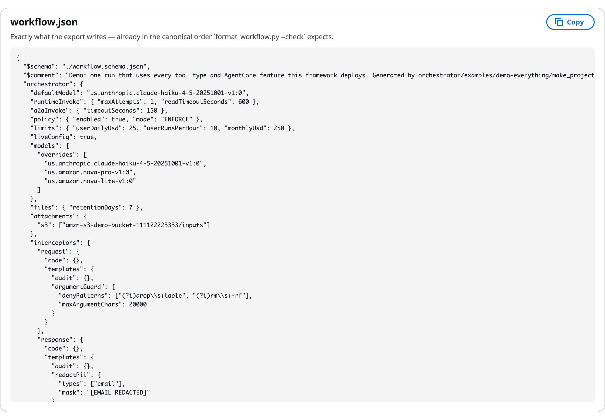

# workflow.json tab

The **workflow.json** tab is the last tab of **Build manually**. It shows the whole file the build stands for, exactly as the export writes it. Use it to see what a change on another tab did, or to copy the file into a review or a repository. The keys themselves are on [workflow.json settings](Workflow_JSON_Reference.md).

# Read the file

The workflow.json tab for the example build:

- The file is exactly what **Export → Download workflow.json only** writes.
- Its keys are in the framework's canonical order, the order `format_workflow.py --check` expects.
- It starts with `"$schema": "./workflow.schema.json"`, so an editor can check it.
- **Export → View workflow.json** in the build header jumps straight to this tab.

# Copy the file

Click **Copy** at the top right. Use the copy to:

- read exactly what a change on another tab did;
- paste the file into a review or a repository;
- check a key name before you look it up on [workflow.json settings](Workflow_JSON_Reference.md).

# Change the file

The tab is read-only. To change the file:

- edit the build on the other tabs or on the canvas;
- ask the [AgentExpress Assistant](AgentExpress_Assistant.md);
- or download it, edit it, and import it back with **Project → Import a file…**. See [Export, edit and import](Export_and_Import.md).

The file holds no secrets and no uploaded documents. Prompts and code written in the build travel in a bundle, not in this file; see [Code bundle and a coding agent](Code_Bundle_and_Coding_Agent.md).

# Check an edited file

When you edit the file outside the control plane, the same rules catch mistakes in several places:

- **Your editor**: the `$schema` line gives completions for the keys allowed by the `runtime` or `type` you chose, underlines a value outside its allowed set, marks a missing required key, and shows each key's default on hover.
- **Import**: the build's header status shows **Valid**, or the errors and warnings, as soon as the file loads.
- **Deploy**: the server checks the build again before anything reaches AWS.

An unknown key is kept, not dropped, so the validator can name it. If a key is not in the framework's reference, nothing reads it.

# Find the matching tab for each block

| Tab | Level | Block in workflow.json |
|---|---|---|
| [Tools](Tools_and_Gateway.md) | Agent | `tools` |
| [Skills](Skills.md) | Agent | `skills` |
| [Memory](Memory.md) | Agent | `memories` |
| [Guardrails](Guardrails.md) | Agent | `guardrail`, `guardrails` |
| [Identity](Identity.md) | Agent, tool and execution plane | `identities`, `authorization.signIn` |
| [Policies](Policies_and_Cedar.md) | Gateway | `orchestrator.policy`, `policies` |
| [Interceptors](Interceptors.md) | Gateway | `orchestrator.interceptors` |
| [Triggers](Triggers.md) | Workflow | `orchestrator.triggers` |
| [Evals](Evaluations.md) | Agent | `evaluators` |
| [Tests](Test_Suites.md) | Build | Stored with the build, not in the file |
| [Settings](Settings.md) | Build | `ui`, `orchestrator`, `authorization` |
| **workflow.json** | Build | Everything |

Each tab's label shows how many items it holds, for example **Tools (8)**. The tab strip scrolls on narrow screens; use the arrows at each end.

# Ask the Assistant

This tab only shows the file, so there is nothing on it for the AgentExpress Assistant to set. The Assistant edits this same file, though, so any key on [workflow.json settings](Workflow_JSON_Reference.md) can be asked for by name, and it can explain the file. Requests you can paste:

- "Explain what the orchestrator block in this build does"
- "Which key adds the review gate after intake?"
- "Set orchestrator.files.retentionDays to 30"

* **Copy** and the **Export** menu are buttons; the Assistant does not download the file.
* It can read a `workflow.json` you attach, as reference. To load an edited file, use **Project → Import a file…**.

More requests are on [Ask the Assistant](Ask_the_Assistant.md).

# Related pages

- [workflow.json settings](Workflow_JSON_Reference.md): the file, section by section
- [Export, edit and import](Export_and_Import.md): download, edit and import back
- [Code bundle and a coding agent](Code_Bundle_and_Coding_Agent.md): the full bundle with prompts and code
